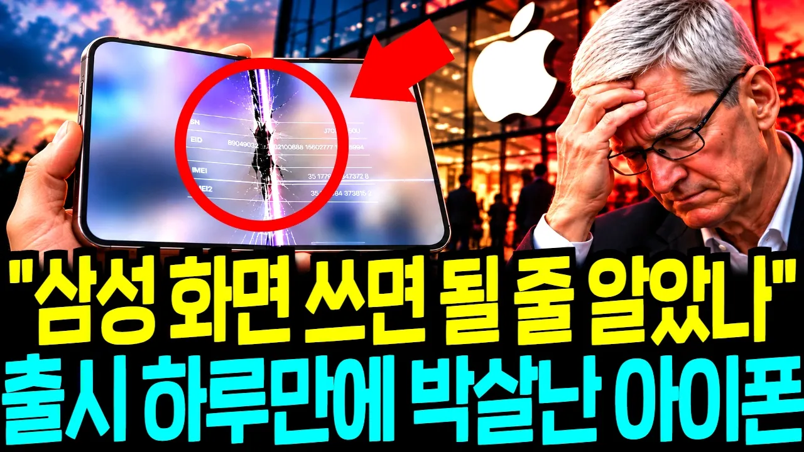

# "삼성만 베끼면 될 줄 알았나?" 애플 첫 폴더블 폰 아이폰 듀오, 출시 하루 만에 화면 '쩍' 갈라지자 미국 전체가 뒤집어진 진짜 이유

## 기본 정보
- **URL**: https://www.youtube.com/watch?v=zJAeytjN74Q
- **채널명**: 우아한 경제
- **구독자수**: 1,600
- **조회수**: 212,428
- **업로드일**: 2026-10-30
- **영상 길이**: 29:19
- **댓글 수**: 55
- **좋아요 수**: 1,181

## 썸네일

---

## 댓글 (추천순 TOP 10)

| 순위 | 좋아요 | 댓글 |
|------|--------|------|
| 1 | 17 | 역시 애플이야, 애초에 한국 부품공급을 아니하였다면 애플은 20년 전에 문닫을 회사였는데. |
| 2 | 16 | 안돼 안돼 액정 교체해도 어짜피 또 깨져 전량 리콜이야 |
| 3 | 24 | 아이폰을 접은이유. 사업을 접을려고. |
| 4 | 3 | ㅋㅋㅋ |
| 5 | 3 | 대한민국의 자존심 삼성을 응원합니다 ❤❤❤ |
| 6 | 5 | 애플을 삼성휴대폰 힌지기술 특허침해로 소송을 해야한다 그래야 중국업체들이 함부로 기술을 훔치는 일이 발생되지않는다 |
| 7 | 6 | 삼전은  저정도면  그냥  바꿔 줌.  삼성폰은 버릴때까지  새폰 처럼 쓰게 해줌.  서비스 직원들이  아주  친절함. |
| 8 | 5 | 이제 애플하고 화웨이 하고 비슷한 수준되는거 아니야... |
| 9 | 7 | 삼성 힌지 돈내고 사용하기 싫어 자체 만들었다 개박살 난거 |
| 10 | 19 | 썩은 사과 갖다 버려라. |
