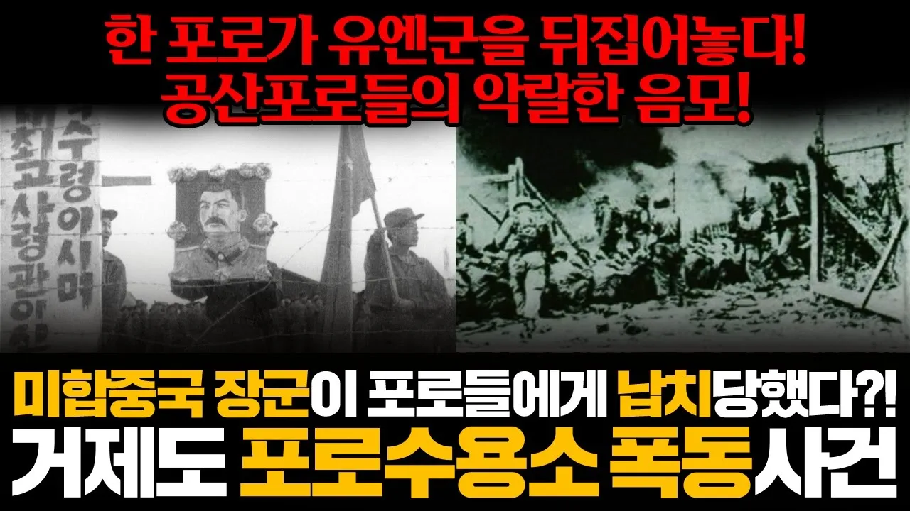

# 미합중국 장군이 포로들에게 납치당하다! 거제도 포로수용소 폭동사건

## 기본 정보
- **URL**: https://www.youtube.com/watch?v=y5oSjRs4F28
- **채널명**: 보처강
- **구독자수**: 3만
- **조회수**: 1,517
- **업로드일**: 2025-06-12
- **영상 길이**: 15:09
- **댓글 수**: 13
- **좋아요 수**: 74

## 썸네일

---

## 댓글 (추천순 TOP 10)

| 순위 | 좋아요 | 댓글 |
|------|--------|------|
| 1 | 5 | 거제도포로수용소폭동이 가져온 파장은 정말로 컸고,나중에 반공포로석방의 파장은 그보다 더컸고..! |
| 2 | 1 | 관측 되기 전까진 자결인지 숙청인지 알수없는 붉은양자물리학 |
| 3 | 3 | 똥별들이 확실히 문제네요ㅋㅋ 인수인계도 똑바로 안 하고 뭐하는 짓인지 |
| 4 | 3 | 군대에서 정훈자료였나? 수송부였지만 시간나면 정훈장교 사무실에서  여러 자료나 교범및 국방일보를 읽어보곤 했는데.....기억나는건 포로 수용소 격리철망에서 밖으로 딱 1미터까지 잡초가 없었다고 기억합니다 잡초를 뽑아서 말려서 담배처럼 피웠다고 하더라구요 그리고 아리까리한데 인도쪽 남아시아 병력이 수용소 방어를 했다고..... 그리고 여의도에서 반공 뭐시기 했을때 200여명을 죽인 북한장교가 있었다고 아는데요......그놈이 이학구란 놈 이군요..... 아쉽지만 저런놈은 껍질을 벗길......마인드를 가졌던 기억이 있네요 포로 수용소에서 밥을 순서대로 만지는 개념으로 계급이 형성됐다고 알고 있습니다 |
| 5 | 2 | 정말 다음번엔 엄청난 영상이 올라 오겠군요!!! 화이팅!!! |
| 6 | 3 | 감사합니다! |
| 7 | 1 | 이거 옛날에 만화책에서 본 사건이네요. 용공포로들에게 붙잡힌 장군 이름이 프란시스 도드 준장이었나? 기억상 대령으로 강등되었다고 그렇게 봤었는데...  포로도 용공포로 반공포로로 갈라졌고... 서울 1945라는 드라마에선 이학구(?) 총좌로 추정되는 인간이 6.25 전쟁 개시 암호 '폭풍'이라고 말하는 장면 있었는데...  이학구는 북한에서 죽었다는 얘기가... |
| 8 | 2 | 와 ㅋㅋ...이게 실화라니 |
| 9 | 3 | 늦었지만 알림뜬거보고 보러왔어요 |
| 10 | 2 | 매번 감사해요 |
