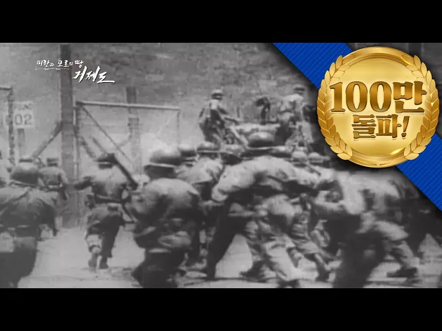

# 피란과 포로의 땅, 거제도 | 6·25전쟁 67주년 특집다큐

## 기본 정보
- **URL**: https://www.youtube.com/watch?v=aV_2NaSUIL4
- **채널명**: KFN
- **구독자수**: 109만
- **조회수**: 1,312,861
- **업로드일**: 2017-06-25
- **영상 길이**: 53:01
- **댓글 수**: 807
- **좋아요 수**: 6,796

## 썸네일

---

## 댓글 (추천순 TOP 10)

| 순위 | 좋아요 | 댓글 |
|------|--------|------|
| 1 | 48 | 본 영상에 출연하신 저희 아버님께서 올해 3월12일 돌아가셨습니다  국립영천호국원에 안장하였고 아버님 생각 날 때마다 본 영상을 찾아 보게 되네요  저희 아버님은 거제도에서 전향하셨어 육군으로 재 입대하시어 군복무 하셨습니다 파란만장한 고난의 세월을 보내신 아버님 사랑합니다........... |
| 2 | 51 | 중공을반드시 없애버리지 않는한 자유 대한민국의 영원한 평화는 보장될 수 없습니다 |
| 3 | 50 | 우리어머니는 황해도석도에서살다가 유엔군 군함이와서그배를타고 온식구가 피난내려와서 거제도에거처하게 되었답니다 이화면을보니 우리아버지 어머니가생각나며 감회가깊습니다 감사드립니다 |
| 4 | 310 | 2019년 2월 18일 21살이라는 나이로 입대를 명받았습니다 이런 아픈 기억 다시는 남지 못하게 나라 잘지키고 오겠습니다! |
| 5 | 22 |  @kmkk9870  ㅋㅋㅋ 왜캐꼬엿냐 |
| 6 | 8 |  @이재윤-l2e  군 면제받았나보죠~ㅋㅋㅋ |
| 7 | 13 | 몸 건강히 잘 다녀오세요^^ |
| 8 | 13 | 응원 해주신 분들 정말 감사합니다! 전역한지는 벌써 5개월 정도 되었네요 ㅎ 군생활을 하면서 힘들기도 했지만 많은걸 배웠습니다! 별탈없고 몸건강히 나라를 지킨 것이 너무 뿌듯하고 같이 생활했던 후임들 선임들 동기들 모두 보고싶지만 시간이 맞지 않고 코로나 때문에 만나기 어려운것이 아쉽네요..ㅠ 어서 코로나가 종식되었으면 좋겠습니다! 어려운 시국에 모두들 건강 조심하시고 복무중인 모든 장병분들 화이팅 입니다! |
| 9 | 8 |  @kmkk9870  총은 잡을줄 아냐?? |
| 10 | 8 | 수고하세요 |
