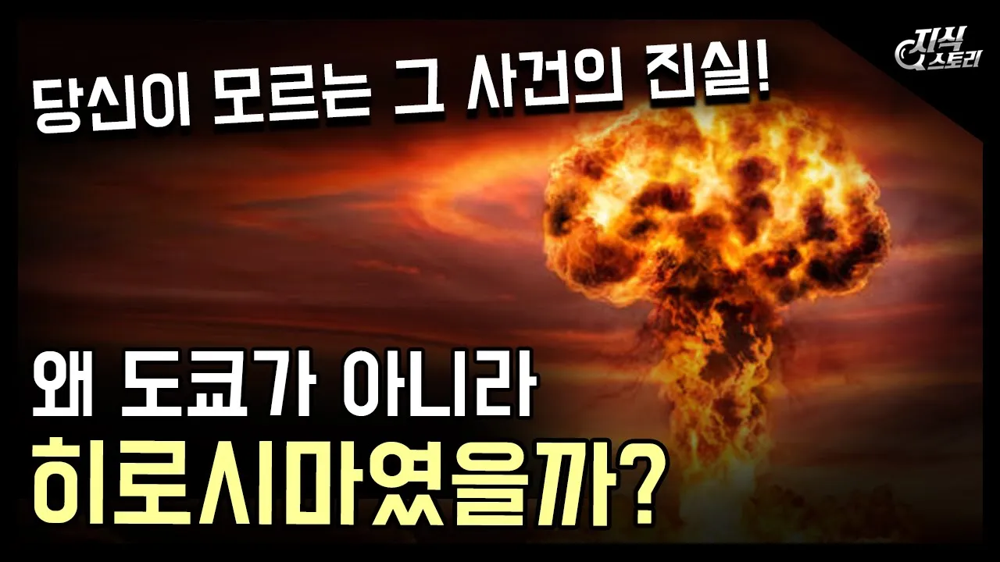

# 미국이 도쿄 대신 히로시마를 선택한 이유 / 우리가 모르는 그 비밀! [지식스토리]

## 기본 정보
- **URL**: https://www.youtube.com/watch?v=4T9qcp_roLc
- **채널명**: 지식스토리 Knowledge Story
- **구독자수**: 68만
- **조회수**: 1,253,657
- **업로드일**: 2020-10-04
- **영상 길이**: 10:32
- **댓글 수**: 1,700
- **좋아요 수**: 16,700

## 썸네일

---

## 댓글 (추천순 TOP 10)

| 순위 | 좋아요 | 댓글 |
|------|--------|------|
| 1 | 324 | 0:29 해당 -는 오타입니다. =이 맞습니다. |
| 2 | 8 | 0:29 해당 부분에 큰 문제가 있어 얘기합니다. E=MC^2는 틀립니다. E=mc^2가 맞는 표기입니다. E=MC^2는 F=ma를 F=MA라고 표현한 것과 같은 것입니다. 물리 뿐만 아니라 과학의 공식들은 소문자 대문자 하나하나가 중요합니다. f는 진동 수이지만 F는 힘이고, G는 만유인력 상수이지만 g는 중력 가속도, E는 에너지지만 e는 반발계수, A는 면적이지만 a는 가속도인 것처럼요.  많은 사람들이 간과하는 부분이고 모르실 수도 있지만 다음 영상부터는 참고하셔서 더 좋고 유익한 영상 만들어주시길 바랍니다. 항상 잘 보고 있어요! |
| 3 | 2 |  @도도-e4t  님 말이 맞아요. 완전히 다른 식이 되 버려요. 옛날에 엔터프라이즈 항모에서도 소문자로 글씨를 만들었지요. |
| 4 | 2 |  @도도-e4t  와 천재... |
| 5 | 1 |  @도도-e4t  ? |
| 6 | 1 |  @도도-e4t  와 씨 천재네 칭찬임 |
| 7 | 2 | @2108박세현 그게 미귝때문은 맞지민 원인재공자는 자기들이라는 사실을 일본답게 안써놨겠군요 |
| 8 | 1 | 휴이,블랙호크,시 스텔레온 해주세요 |
| 9 | 1 | 냉 |
| 10 | 1 | 네 |
