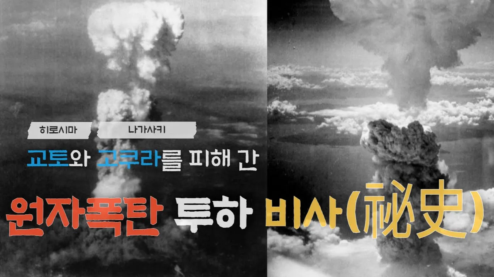

# 히로시마, 나가사키 원자폭탄 투하 비사(祕史) ; 교토와 고쿠라 시민들은 전생에 나라를 구했던 걸까?

## 기본 정보
- **URL**: https://www.youtube.com/watch?v=55C5HLeARLk
- **채널명**: 북마존(Bookmazon)
- **구독자수**: 3,750
- **조회수**: 527
- **업로드일**: 2021-07-23
- **영상 길이**: 12:02
- **댓글 수**: None
- **좋아요 수**: 3

## 썸네일

---

## 댓글 (추천순 TOP 10)

| 순위 | 좋아요 | 댓글 |
|------|--------|------|
