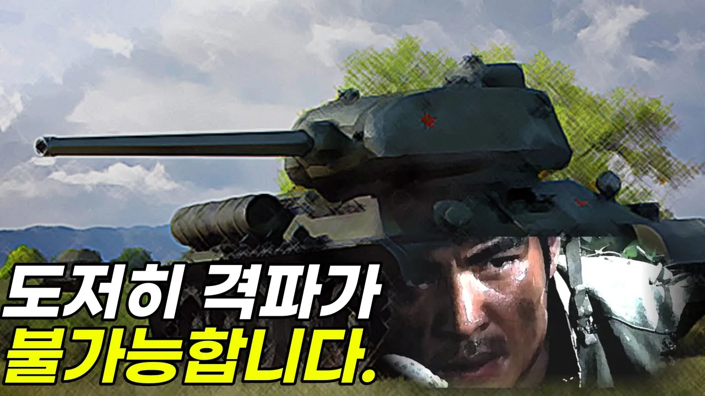

# 2차대전 당시 미군은 티거전차도 막았는데 국군은 왜  T-34/85전차를 막을 수 없었을까?

## 기본 정보
- **URL**: https://www.youtube.com/watch?v=rNIfenvKZoA
- **채널명**: Everything Box TV, [God of War
- **구독자수**: 11만
- **조회수**: 127,965
- **업로드일**: 2023-04-23
- **영상 길이**: 14:55
- **댓글 수**: 611
- **좋아요 수**: 1,779

## 썸네일

---

## 댓글 (추천순 TOP 10)

| 순위 | 좋아요 | 댓글 |
|------|--------|------|
| 1 | 31 | 정말 좋은 내용이네요.   경영학 교과서에 실려야 될 내용입니다 |
| 2 | 1 | HEAT탄 쏴야 하는데 HEAT탄 준비가 안 되어서 HE로 쐈는데 꿈틀하고 말았답니다.
 전쟁 물자도 준비가 안 되어있고, 훈련도 안 되어있고, 지휘부의 무능, 정치권의 무지까지~ |
| 3 | 7 | 응원의 좋은 말씀 감사합니다. 2차세계대전. 특히 노르망디 상륙작전은 연합군이 2년동안 갈고 딲아왔던 준비된 작전이었습니다. 당시 연합군은 영국에서 실전같은 훈련을 쌓으며 유럽 상륙을 준비했습니다. 미군이 국군에게 전차를 지원하지 않은 이유는 첫째는 경제적 이유,  둘째는 한반도 지형은 탱크가 필요없다고 봐서였습니다. 미군은 탱크 대신에 2.36인치 바주카포와 57밀리 대전차포를 공여했습니다. 물론 이 무기들로 T-34/85를 쉽게 파괴할 순 없었습니다만 그렇다고 불가능한 것은 아니었습니다.  왜냐하면 2차대전 때 미군들은 했기 때문입니다. 그런데 진실을 말하자면 당시 국군은 갖고 있는 무기조차 활용할 교육훈련을 안했습니다. 탱크는 측면과 후면이 약하다. 그리고 탱크 파괴용 포탄이 따로있다. 지금은 상식이지만 당시는 이 사실도 아는 사람이 거의 없었습니다. 이것은 백선엽 장군도 증언을 했습니다.  따라서 결론은 무기도 강력하지 않았는데 갖고 있는 무기조차 활용하는 훈련을 안했다. 이것이 진실입니다. |
| 4 | 0 | ​ @allofwar 대전차훈련을 집중적으로어떻게 받나요? 미군이훈련을 잘시키지도않는데 집중적으로받을수가없죠 |
| 5 | 116 | 군복무 시절 진지방어훈련중 전차가 지나가는데 멀리서부터 굉음과 진동이 느껴지는데  진지에 흙이 무너져내릴정도로 진동이 심해 찔끔할 정도로 무서웠어요. 알고도 이 정도인데 대전차훈련이 안된 보병들인 우리 선배병사님들은 얼마나 두렵고 공포스러웠을까요? 그럼에도 불구하고 우리나라를 지켜주혀서 다시 한번 감사드립니다. |
| 6 | 11 | 그당시책임자들에책임을물어야햇다. 6,25때탱크가물밀듯이내려와 탱크잡는무기가 없는줄알았다. 북에탱크가그렇게있으면 당연히 훈련을시켰어야지. 나쁜놈들 |
| 7 | 3 | 훈련이 안된 국군 |
| 8 | 1 | 105mm는 철갑탄도 아닐텐데 |
| 9 | 3 | 겁보병사😅 |
| 10 | 10 | 처음 미군이 바주카가 안통한다는 국군의 말을 무시하고 겁쟁이 취급했다가 직접상대해보고 개털림 거기다 56미리 대전차포라니 차라리 60미리 박격포 럭키샷이 전차잡을 확률 높겠내 |
