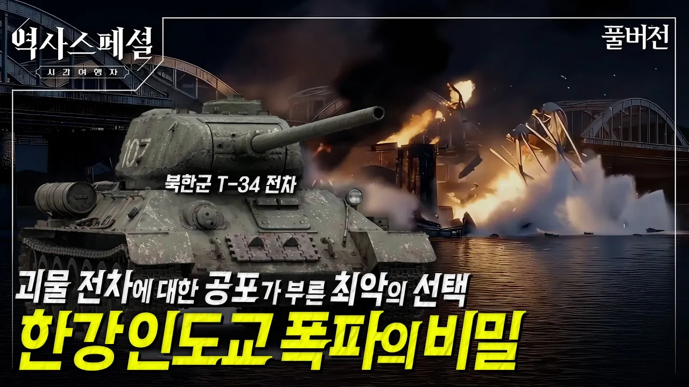

# [4K풀] 6.25 개전 초 국군이 후퇴를 거듭했던 진짜 이유 | 역사스페셜 시간여행자 "T-34를 막아라, 한강 인도교 폭파의 비밀"(KBS_2026.6.21.방송)

## 기본 정보
- **URL**: https://www.youtube.com/watch?v=fA_wQ2dBhRs
- **채널명**: KBS 히스토리
- **구독자수**: 106만
- **조회수**: 76,841
- **업로드일**: 2026-06-21
- **영상 길이**: 49:00
- **댓글 수**: 389
- **좋아요 수**: 1,051

## 썸네일

---

## 댓글 (추천순 TOP 10)

| 순위 | 좋아요 | 댓글 |
|------|--------|------|
| 1 | 48 | 지승현 배우 연기 너무 실감난다 진짜 그때로  시간여행한것 같음 |
| 2 | 36 | 참전용사분들과 당시 머나먼 타국의 자유민주주의를 지키기 위해 제일 소중한 생명을 바쳐서 희생하신 유엔군 분들에게도 감사합니다. 항상 기억하겠습니다. |
| 3 | 18 | 열악한 상황에도 나라를 지키기 위해 목숨바쳐 헌신하신 순국선열들의 노고에 진심으로 감사드립니다.😢 |
| 4 | 24 | 6.25 전쟁일이 곧이군요.. 이름모를 6.25 전쟁 참전 국군 사병들에게 무한한 감사를 전하며, 다음생애는 유복한 가정에서 태어나길 바래봅니다. |
| 5 | 29 | 48:06 6.25 X-FILE 1편 한강방어선 전투, 2편 인천상륙작전, 3편 장진호 전투, 4편 백마고지 전투... 다음 라인업이 후덜덜하네요.... |
| 6 | 11 | 참전용사들의 희생이 있어 오늘의 대한민국이 있을수 있었습니다.너무나 감사합니다. |
| 7 | 7 | 역사스페셜 제작진 분들, 매 회 명연기를 펼쳐주시는 지승현 배우님, 각 전문 분야에서 인터뷰해주시는 교수님들..모두에게 정말 감사합니다. 매주 본방부터 시작해서 주중에도 보고 또 보는 역사스페셜입니다. |
| 8 | 31 | 순국선열 호국영령께 항상 감사합니다 |
| 9 | 6 | 이런 역사적인 사실을 배우고 다시 반복되지 않게 철저히 방비 해야겠다. |
| 10 | 4 | 육이오 하사출신의 친할아버지가 참전용사였습니다 매년 육이오 되면 생각이 많이납니다  그분들이 없었다면 생각하기도 싫습니다 감사합니다 |
