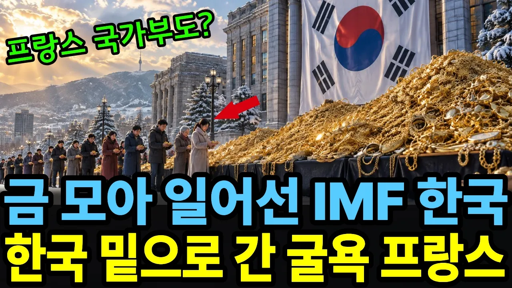

# IMF 때 낙제점 받은 한국이, 28년 만에 최고 등급 프랑스와 자리를 바꾼 이유

## 기본 정보
- **URL**: https://www.youtube.com/watch?v=4jfeGAyn9S0
- **채널명**: 지구촌경제학
- **구독자수**: 1,890
- **조회수**: 24,137
- **업로드일**: 2026-10-15
- **영상 길이**: 14:37
- **댓글 수**: 14
- **좋아요 수**: 110

## 썸네일

---

## 댓글 (추천순 TOP 10)

| 순위 | 좋아요 | 댓글 |
|------|--------|------|
| 1 | 5 | 지금처럼 나라가 둘로 갈라졌으면 금반지를 내놓는게 불가능했었을거예요. 앞으론 나라가 아무리 어려워도 금반지 내놓는 일은 없을거 같아요 토착매국세력과 민주세력의 대결 |
| 2 | 1 | 그 시절 나도 직격탄을 맞았지만 그땐 금반지를 내놓는 사람들을 부러워할 만큼 사정이 좋지 않았다,그해 겨울 한달 일하고 80만원 받아서 보일러 기름 한드럼 넣고나면 집사람하고 둘이 먹고 살기도 빠듯한 겨울이었다. |
| 3 | 2 | 우리집에  금거북이 4개 기부해서요 저고딩때요 |
| 4 | 0 | 올라갈수록 겸손과 양보가 필요하고, 익을수록 숙이는 나락처럼... |
| 5 | 1 | 외국인들이 오해? 아니 한국에서 구라치는거 금모으기운동은 금을자선한게아니다 돈받고 판거지 |
| 6 | 0 | 그 당시만해도,, 아니 지금까지도 프랑스는 아프리카 지역에서 거의 식민지를 간접적으로 운영하고 있죠.  그 치밀한 역사가 언제 밝혀질지... |
| 7 | 0 | 당시나도 관리과 있었는데금리무시하고돈을빌리던시기   이후lmf 결과 한국의 자산 몰락 과도한 imf  사무실쪽으로  똥오줌 뿌린다 |
| 8 | 0 | 근데 그렇게해서 모은 금 일부 권력자들이랑 정부에서 ㅃㅣㅇㄸㅏㅇ치지 않았음?? 그때 내놓지 않고 그냥 모아뒀다가 26년 1월 말이나 3월 초쯤에 한꺼번에 팔았어야 했음..... |
| 9 | 0 | 금 모으기 이후에도 금값이 더 떨어졌었는데 |
| 10 | 1 | 좀 오버 좀 하지마라.양산형 채널주제에 존나 나대네 거의 대부분 비슷한 내용 |
