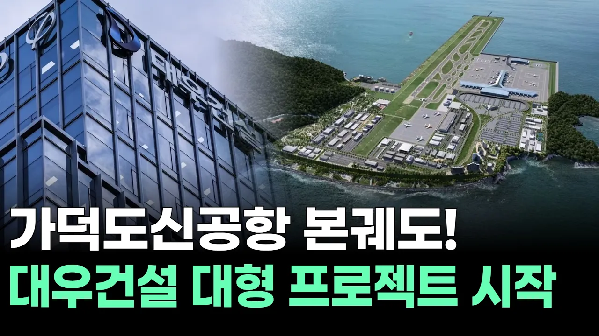

# 가덕도신공항 본궤도! 대우건설 대형 프로젝트 시작

## 기본 정보
- **URL**: https://www.youtube.com/watch?v=tekh9nCh8OM
- **채널명**: 서울경제TV
- **구독자수**: 54만
- **조회수**: 3,049
- **업로드일**: 2026-03-28
- **영상 길이**: 9:34
- **댓글 수**: 2
- **좋아요 수**: 30

## 썸네일

---

## 댓글 (추천순 TOP 10)

| 순위 | 좋아요 | 댓글 |
|------|--------|------|
| 1 | 0 | 도데체,  가덕도 신공항은 언제 되는 검니까 ?? 일본은 국제공항이 33개나 됨니다. |
