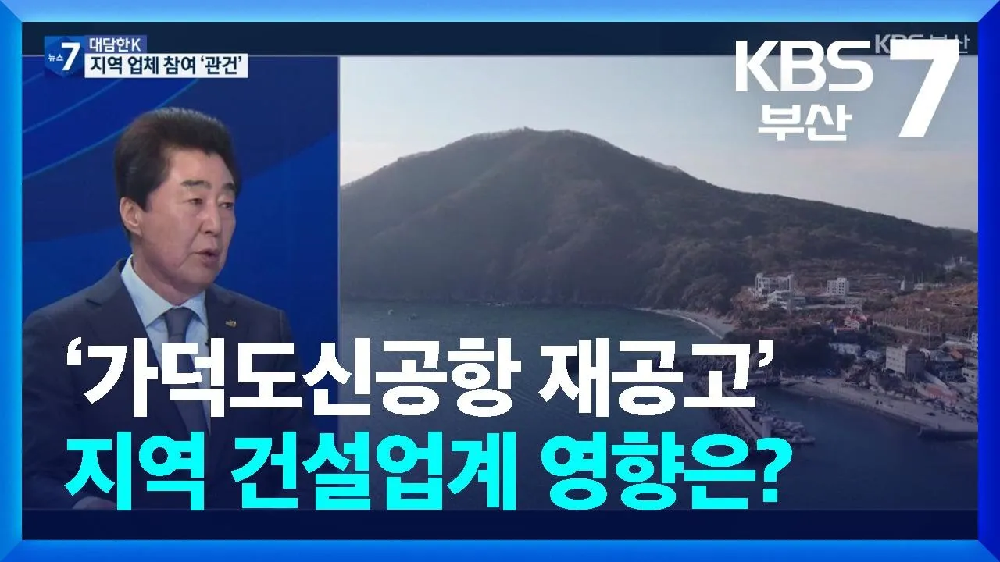

# [대담한K] ‘가덕도신공항 재공고’ 지역 건설업계 영향은? / KBS  2026.01.28.

## 기본 정보
- **URL**: https://www.youtube.com/watch?v=1Q8nWKZi5qI
- **채널명**: KBS 뉴스 부산
- **구독자수**: 10만
- **조회수**: 3,606
- **업로드일**: 2026-01-28
- **영상 길이**: 9:25
- **댓글 수**: 55
- **좋아요 수**: 34

## 썸네일

---

## 댓글 (추천순 TOP 10)

| 순위 | 좋아요 | 댓글 |
|------|--------|------|
| 1 | 8 | 부산시민도 참말로 미련스런 똥고집이 스스로 도시를 슬럼화 만들고 있다. 산전수전공중전을 수없이 겪은 건설사인 전문건설사 이미 예언한 과학적 자료를 무시한 댓가가 앞으로도 상당할거야. 이미  김해공항을 확장했더라면 지금 부산은 경제가 대호황일 것이야. 과학을 무시한 감정이 무한공항참사를 만든다. 상식을 무시하시마라. |
| 2 | 1 | 확장했더라면 그 공항 확실하게 망하는데 몇년 안걸린다. 그 컨설팅 업체가 참여한 터키 공항 V자 활주로 만들고 2년만에 공항 폐쇄했단다.... |
| 3 | 1 | 쉽지않겠어😢 |
| 4 | 2 | 지역건설업계 좀 제발 배제해라 지역 공무원들 다들 무슨 지 주머니인냥 용돈주는 업체 끼워넣으라고 하는 것도 지겨운데 공동원가 청구해도 주지도 않는 지역업체 제발 |
| 5 | 2 | 일대일로로 가는겨? |
| 6 | 1 | 이러면 그냥 하지 말자 이미 90년대에 김해 공항 포화가 되어서 그 때 했어야 하는 데 안상영이 허남식이 3선하는 동안 중앙 정부의 지원을 받아서 추진했어야 하는 데 이제서야 하는 것도 웃기고 대구 경북 의원들의 반대에 밀려 성과도 못 이룬 부산 시장들 보면 갑갑하다 |
| 7 | 2 | 대우건설.?. 부채비율 228.8%(2025년3분기 말) 부채 총액 9조 6,419억...구조조정 중 인듯 사실관계 확인해 보소 |
| 8 | 6 | 현대 포스코 롯데 금호에 이어 KCC건설·효성중공업·HL디앤아이한라·쌍용건설·코오롱글로벌이 지분 버리고 가덕도 사업 포기선언 호남토착 건설사인 중흥건설 산하의 대우건설만이 컨소시엄 지키기. 누굴 위한 사업일까? |
| 9 | 11 | 현대건설조차 포기한 걸 누가 맡을 건데? 일찌감치 포기하고 원래계획대로 김해공항 확장으로 선회해라 확마 |
| 10 | 0 | 포기 잘했어. 철근 빼먹는건 기본인 건설사라서. |
