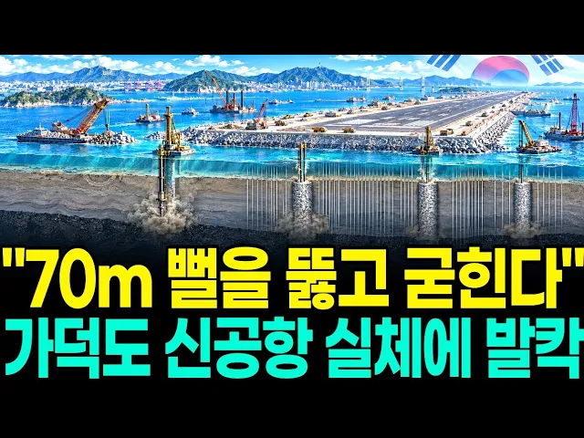

# "70m 뻘을 뚫고 굳힌다" 가덕도 신공항, 일본 간사이도 실패한 바다 공사를 밀어붙이는 진짜 이유

## 기본 정보
- **URL**: https://www.youtube.com/watch?v=nrAuS4LkjUs
- **채널명**: 지식발굴단
- **구독자수**: 3만
- **조회수**: 1,898
- **업로드일**: 2026-10-11
- **영상 길이**: 29:01
- **댓글 수**: 5
- **좋아요 수**: 84

## 썸네일

---

## 댓글 (추천순 TOP 10)

| 순위 | 좋아요 | 댓글 |
|------|--------|------|
| 1 | 3 | 가덕도 뻘 다지는 돈 보다 김해공항 산 깎아 내는 게 돈이 덜 들어갈 것 같은데... 훨씬 빠르고.....ㅎ |
| 2 | 0 | 24시간 떠고 내리는것이  중요 하지요? |
| 3 | 0 | 정치인들이 불땐 뻘짓거리 ! |
