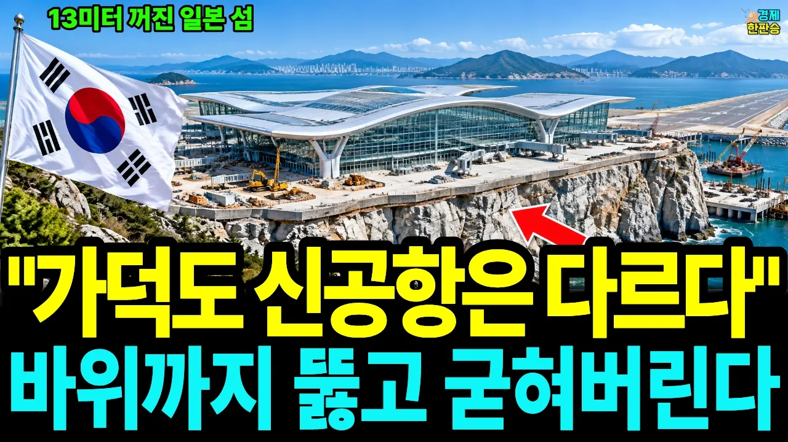

# "세계 최고 수준임을 알리는 절호의 기회" 가덕도 신공항 / 일본 간사이와 바닥부터 다른 진짜 이유

## 기본 정보
- **URL**: https://www.youtube.com/watch?v=vQK2Yp4CWsQ
- **채널명**: 경제한판승
- **구독자수**: 926
- **조회수**: 118,862
- **업로드일**: 2026-10-07
- **영상 길이**: 28:29
- **댓글 수**: 151
- **좋아요 수**: 1,515

## 썸네일

---

## 댓글 (추천순 TOP 10)

| 순위 | 좋아요 | 댓글 |
|------|--------|------|
| 1 | 3 | 뚫고 들어가지도 못하고 실패했는데..... |
| 2 | 0 | 잘 됐으면 좋겠습니다. 파이아~~~ |
| 3 | 0 | 國家敎訓   正直. 眞實. 正道. |
| 4 | 19 | 현대가 떠나버렸다며 |
| 5 | 1 | 포기하고 김해공항 확장하라! |
| 6 | 0 |  @이성주-o5b  그게 되겠니? 생각이라는걸 해라 |
| 7 | 0 |  @이성주-o5b  그게 되겠니? 생각이라는걸 해라 |
| 8 | 0 |  @이성주-o5b  그게 되겠니? 생각이라는걸 해라 |
| 9 | 0 | ​ @폭풍간지트롤짱  생각해서 말한 겁니다. 바다에 매립과 인프라 건설에 20조 투자하고 침하문제로 활용이 않되면 큰 문제죠. 간사이 공항은 활주로가 2개라 번갈아 보수힙니다. 여기는 활주로가 1개입니다. 인구도 줄고 있는데. |
| 10 | 0 | 맞습니다, 작년 5월에 현대건설이 손을 뗐지요. 그 까닭은 영상 0:58과 20:02에 담았습니다. 끝까지 보시면 그 뒤에 누가 그 바다에 들어섰는지도 보실 수 있습니다. 댓글 고맙습니다! |
