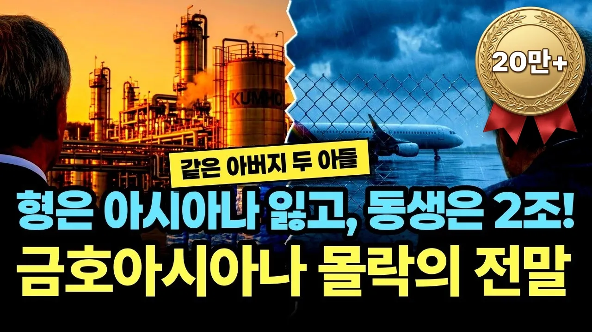

# 형은 아시아나를 내줬고, 동생은 한 해 2조 4천억을 벌었습니다… 금호아시아나 몰락의 전말

## 기본 정보
- **URL**: https://www.youtube.com/watch?v=HwzF1WnFxM4
- **채널명**: 경제꽈배기
- **구독자수**: 6,420
- **조회수**: 266,451
- **업로드일**: 2026-10-18
- **영상 길이**: 23:03
- **댓글 수**: 83
- **좋아요 수**: 708

## 썸네일

---

## 댓글 (추천순 TOP 10)

| 순위 | 좋아요 | 댓글 |
|------|--------|------|
| 1 | 10 | 박삼구가 뻘짓만 안했어도 직원들이 이렇게까지 고통받진 않았을텐데.... |
| 2 | 16 | 최근  러루/이란전쟁 시즌에 금호석유화학은 예상하지못한 엄청난 수익으로 아마도 박찬구일가의 지배력은 더욱 굳건해졌을것이다. |
| 3 | 47 | 박삼구  자기  욕심때문에  다  날렸음..... |
| 4 | 2 | 하이닉스 인수할수도 있었죠 그당시 하이닉스 인수를 했다면? SK는 하이닉스 울며겨자먹기씩으로 하이닉스를 인수를했죠(물론 LG도 기회가있었으나 거절했고) |
| 5 | 16 | 금호 대우건설 인수로 그냥 한방에 나락갔지 웅진도 극동건설 인수 하면서 글로벌 경제위기때 나락 하던거나 잘하지 건설에 손을대냐 |
| 6 | 6 | 박삼구 회장도 잘못이지만 징역 10년형을 2년 6개월로 낮춰준 2심 법원 판사들도 금호그룹을 망가뜨리는데 큰 역할을 했음. |
| 7 | 13 | 아오... 진짜 계속 생각해도 열받습니다.... 형이 완전 말아 먹어 가지고 금호그룹은 중견기업으로 떨어졌으니까요... 인수 한번 잘못했으면 그 다음에 하지 말았어야 했는데 또 무리하게 인수를 해가지고 그룹이 저리됐으니... 더군다나 아시아나항공은 적자가 나오기도 힘든 구조였는데, 순식간에 빚더미에 앉아서 대한항공에 매각되고.... 에휴.... 동생은 재빨리 나와서 회사 분리한게 다행이었죠.... 최후의 방법으로, 금호석유화학에서 아시아나항공을 인수하려고 했는데, 박삼구와 박세창이 금호석유화학에서 입찰 참여 할 수 없다고 말하면서 반발했고, 결국 아시아나항공은 대한항공으로 넘어갔습니다 ㅠㅠ |
| 8 | 0 | 사실 대한통운을 인수했던 것 까지는 괜찮았습니다. 단숨에 재계서열을 끌어올리고 물류업계 라이벌 한진을 따돌릴 수 있었으니까요.  그런데, 대우건설을 인수한건 오버였지요. 이미 건설회사인 금호산업 건설부문(현 금호건설)을 가지고 있었고, 대우건설보다는 작아도, 금호건설은 공항건설이나 자사의 플랜트 건설로 이름 높은 회사였으니까요.  순서상으로는 대우건설을 먼저 인수하고, 그 다음 대한통운을 인수한것이지만, 암튼 막대한 자금을 동원하여, 회사를 인수했지만,  2~3년도 못버티고 도로 토해내는 삽질을 했지요.  그 과정에서 회사의 상징이자, 캐쉬카우인 아시아나항공과 금호타이어 마저 잃으면서, 회사는 완전한 구멍가게로 전락해버렸지요.   그룹 내 신성장 동력도 없고, 남은거라곤 금호건설과 금호고속 그리고 박삼구회장이 개인소유에 가까웠던 잡다한 용역회사들 뿐인데, 용역회사들은 아시아나가 떨어져나가면서 쓸모 없어졌고, 금호건설은 부채비율마저 높아서 쉽지 않네요. |
| 9 | 34 | 애경기업하고 똑같네 재벌2세의 무식과 욕심으로 그룹 망하기 시전. |
| 10 | 4 | 재벌 3세 망나니 지가 질나서 그 위치인줄 아는 전형적인 정신박약 수준의 인간이 탄탄한 굴지의 기업을 어떻게 말아먹는지 잘 보여줌 |
