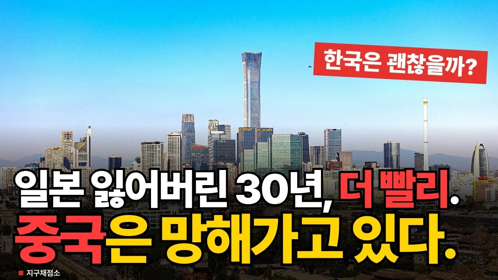

# 세계 경제 2위 중국의 실체, 인구만 많은 중진국인가? 한국은 괜찮을까

## 기본 정보
- **URL**: https://www.youtube.com/watch?v=DHTNBT_yuF0
- **채널명**: 지구채점소
- **구독자수**: 97
- **조회수**: 19,896
- **업로드일**: 2026-10-22
- **영상 길이**: 15:17
- **댓글 수**: 24
- **좋아요 수**: 263

## 썸네일

---

## 댓글 (추천순 TOP 10)

| 순위 | 좋아요 | 댓글 |
|------|--------|------|
| 1 | 10 | 영상 너무좋은데… 샥샥 소리 너무 거슬리네요 없는게 나을거 같아요 영상에 집중이 안됩니다 |
| 2 | 4 | 다음영상부터는 넘기는 소리 없애겠습니다! ^^ 좋은 피드백 감사드립니다 |
| 3 | 3 | 나는 할때 피드백 안들었는데.. 주인장 일잘하네요 내용도좋고 구독 저점매수 합니다🎉 |
| 4 | 5 | 유럽 일본 중국 걱정 할때가 아닙니다 대한민국도 망해가는데 유럽 일본 중국을 따라갑니다 |
| 5 | 3 | 중국 실인구 7억~9억 사이임 |
| 6 | 2 | 2초 간격으로 바람 빠지는 소리는 왜 내보내는지 정신이 하나도 없네. |
| 7 | 1 | 지금 지구상에서 경제 망해가는 나라가 어디 중국뿐 인가 ? 사돈 남말하고 앉았네. (유렆, 특히 프랑스, 이태리가 그렇고) 당장 우리 경제도 좀 들여다보세요. 맨날 만만한게 중국 때리기인가 ?  ㅊㅊㅊ |
| 8 | 8 | 공산주의 가 망할수가 있나요? 어차피 공산당은 말단공산당 간ㅇ부가 중국의 최고 부자였던 헝다보다 더 위에 있는게 현실이며 아무도 공산당 보단 높으면 절대 안됩니다 그게공산당 원칙 입니다 고로 잘살고 있는 중공 인민들은 시진핑 공산당우두머리의 머슴이며 하인이며 종입니다 그이상 그이하도 아닙니다 |
| 9 | 2 | 공산당 힘은 실로 어마어마합니다. 모든 돈 되는일이라면 다 관여할겁니다 장기적출같은거 마저도요 |
| 10 | 5 | 반환점 조차 못 간체 원위치로 돌아가는 중국. 한국 .일본은 그래도  반환점은 돌앗음 |
