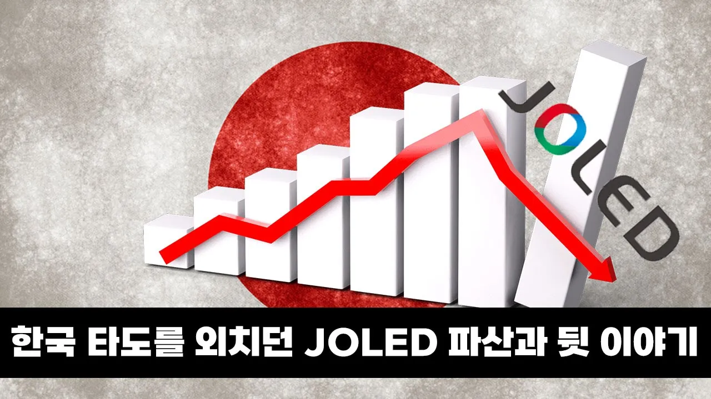

# 한국을 비웃던 일본의 OLED가 망한 이유

## 기본 정보
- **URL**: https://www.youtube.com/watch?v=WzwxpYkwV-4
- **채널명**: ColorScale
- **구독자수**: 20만
- **조회수**: 97,247
- **업로드일**: 2023-05-11
- **영상 길이**: 19:15
- **댓글 수**: 344
- **좋아요 수**: 2,372

## 썸네일

---

## 댓글 (추천순 TOP 10)

| 순위 | 좋아요 | 댓글 |
|------|--------|------|
| 1 | 30 | 컬러스케일 구독은 http://bit.ly/32PAy5F 멤버십 가입으로 컬러스케일 응원하기 - https://www.youtube.com/channel/UCRqYpgUV0xPDWignRgTzp6g/join  지금 시점에서 한국은 OLED 제조 시장에서 가장 강력한 지위를 가지고 있습니다. 중소형 OLED는 삼성 디스플레이가, 대형 OLED는 LG 디스플레이가 각각 장악하고 있죠. 하지만 처음부터 이랬던 것은 아니었습니다. 코닥이 최초의 OLED를 개발한 이래 일본 기업들은 우리나라 기업들보다 앞서서 OLED 디스플레이 연구, 개발에 뛰어들었고 실제 제품 탑재 역시 더 빨랐습니다.  하지만 일본 기업들은 OLED 대량 생산에 적극적이지 않았습니다. 그 사이 삼성 디스플레이가 중소형 OLED의 대량생산에 뛰어들었고, 일본에서는 이를 두고 '후지산을 물구나무로 오르려는 꼴'이라며 비웃었습니다. 하지만 삼성 디스플레이는 그 일을 해 냈습니다. 그리고 뒤늦게 한국을 견제하기 위해 소니와 파나소닉의 OLED 사업부를 합치고 일본 정부가 자금을 지원한 JOLED는 그렇다할 성과를 내지 못하고 파산보호를 신청했습니다.  OLED 대량 생산이 왜 어려운지, 뒤늦게 '타도 한국'을 외치며 만들어진 JOLED가 망한 이유는 무엇인지 영상에서 함께 살펴보시죠.  * 본 영상은 OLED 패널 제조에 대한 내용을 다룬 것으로 OLED 패널 제조를 위한 재료, 장비 등의 산업과는 구분해서 보셔야 합니다. OLED 제조에 필요한 다양한 소재, 장비(영상에서 인용된 캐논토키사의 증착장비 등)분야에서는 여전히 일본이 상당한 경쟁력을 보유하고 있습니다.  [참고 자료] 1. JOLED 홈페이지 - https://www.j-oled.com/eng/ 2. Tang, Ching W., and Steven A. VanSlyke. "Organic electroluminescent diodes." Applied physics letters 51.12 (1987): 913-915. 3. Burroughes, Jeremy H., et al. "Light-emitting diodes based on conjugated polymers." nature 347.6293 (1990): 539-541. 4. 캐논토키 OLED 제조과정 설명 영상 - https://youtu.be/b6XayNkhdyo  #joled #oled #samsungdisplay   0:00 JOLED 파산 0:56 OLED의 역사 2:10 OLED 제조가 어려운 이유 6:41 일본이 망설인 이유 7:45 삼성, LG의 성공 10:19 일본의 뒤늦은 후회와 선택 11:43 고분자 OLED 15:38 한국 vs 일본, 한국 vs 중국 18:14 마무리 |
| 2 | 245 | 반대로 울나라도 방심하지 말고 조심해야 할듯요 |
| 3 | 69 | 물론이죠. 중국의 추격이 매섭습니다 |
| 4 | 22 | BOE가 미친듯이 쫓아오고 우리나라 개발자도 중국정부가 미는 놈들이 돈뿌리기 시작하면 가겠지.. |
| 5 | 9 | ​ @NoEyeDear96  이미 많이 갔죠... |
| 6 | 1 | ​ @xanaxxoxo 잡혔으면 제품 추천좀 42c2 팔고 옮기게 얼마나 싸고 나음? |
| 7 | 0 | ㅛ😂 |
| 8 | 0 | ​ @XANAX  진짜 잡혔으면 추천좀 |
| 9 | 0 |  @xanaxxoxo  네이밍부터 냄새가 ㅋㅋ |
| 10 | 24 | 국책기업이 흥하는 경우와 망하는 경우를 중국, 일본의 사례가 양면적으로 보여주는듯 |
