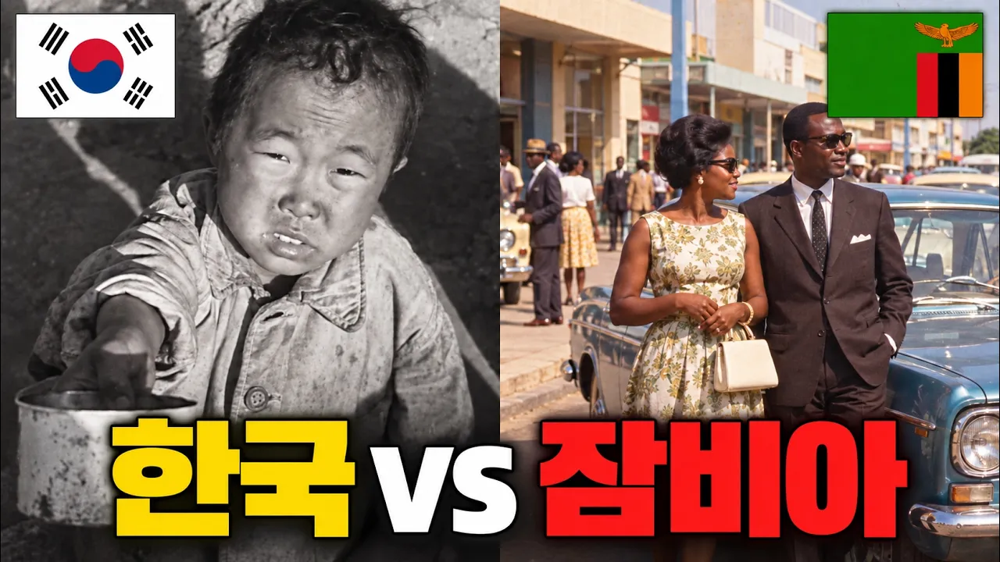

# 한국보다 잘살던 나라는 왜 한국처럼 되지 못했을까?

## 기본 정보
- **URL**: https://www.youtube.com/watch?v=0z9pDLJYuRQ
- **채널명**: Morong World - How the World Works
- **구독자수**: 598
- **조회수**: 288,940
- **업로드일**: 2026-10-01
- **영상 길이**: 10:35
- **댓글 수**: 311
- **좋아요 수**: 943

## 썸네일

---

## 댓글 (추천순 TOP 10)

| 순위 | 좋아요 | 댓글 |
|------|--------|------|
| 1 | 20 | 구독하고 더 재미있는 이야기들도 만나보세요 꽥~🐤🐤 https://www.youtube.com/watch?v=IjGnmFSDOWE&list=PLTYOCquedLp8&index=4 |
| 2 | 1 | 그것도 맞는데 안일하게 살았죠 |
| 3 | 141 | 자원에 의지한국가 vs 자원이 없으니 기술에의지한 나라 |
| 4 | 10 | 크.. 주모 술한상 내오소!🐥 |
| 5 | 29 | 자원이 많아도 내륙국은 바다접한 자원적은 국가보다 어려워짐... 극단예로 지금의 몽골 자원을 팔아 일정유지는 할수있으나 크게 자원개발해도 자원팔로개척에 무수한 인프라구축비 들고 주변국이 방해하면 그도 끝장나고... 요르단같은경우 사우디에 오만의원유묻힌땅과 바다접한사우디땅을 교환 신의한수였다 평가.. 물론 베네스엘라처럼 원유바다 다 있지만 원유정제기술도 못갖추면 기술없이 바다 있어도 안되지만 사실은 타국기술도입또는 자국이개발하면 되는거지만 그래도 안되는게 미국재제로 타국과 경제적교류전체 통제로 수출도 못하긴함 |
| 6 | 143 | 근데 모든걸 고려해도 내륙국인게 가장 큼.. 무역을 할 수가 없자나,.. |
| 7 | 10 | ㅠㅠ 한국은 반쯤 섬나나라고 보는게 맞는 것 같아요.. |
| 8 | 31 |  @morongworld  바다가 있고 해양 무역이 가능한게 진짜 필수 조건이죠 수출국으로써 살아 남기 위해서는.. 몽골도 보면 진짜 안타깝죠 |
| 9 | 7 | ​ @morongworld  그래도 해상권은 자체적으로 유지한단게 어디에염 스탄국가들이나 사하라 내룩국가들은 진짜 위치가 암울한데 |
| 10 | 3 |  @Gordon-rb7nd  맞습니다 ㅠㅠ 그나마 다행인 걸까 🐤🐤 |
