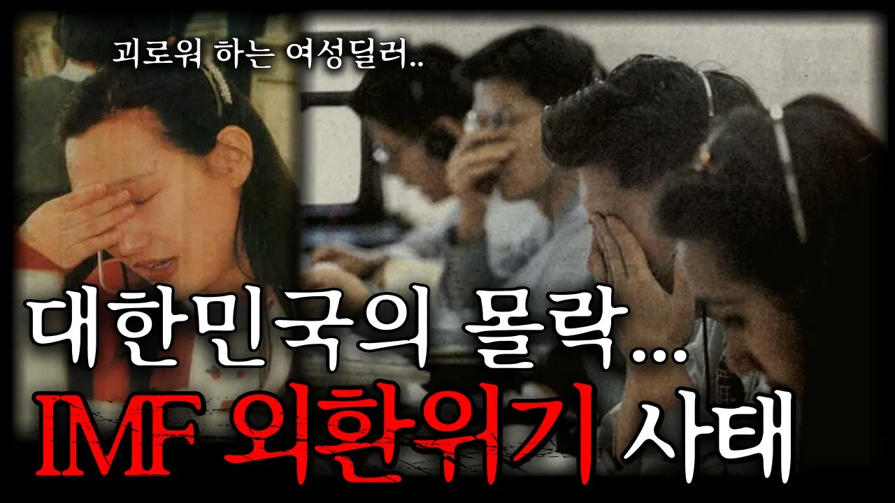

# 대한민국 사상 초유의 경제위기, IMF 외환위기 사태

## 기본 정보
- **URL**: https://www.youtube.com/watch?v=jl7bw372egc
- **채널명**: 궁금소
- **구독자수**: 100만
- **조회수**: 934,416
- **업로드일**: 2024-03-29
- **영상 길이**: 12:46
- **댓글 수**: 1,000
- **좋아요 수**: 6,931

## 썸네일

---

## 댓글 (추천순 TOP 10)

| 순위 | 좋아요 | 댓글 |
|------|--------|------|
| 1 | 601 | 집에있던 금 다 나라갖다 바쳤더니  교과서에 imf 원인 : 국민들의 과소비 ㅇㅈㄹ ㅋㅋㅋ |
| 2 | 6 | ㄹㅇ????? |
| 3 | 39 | 지금 환율 개박살난거 국민들이 해외투자 많이해서 그렇다는말이랑 비슷하잖아? |
| 4 | 10 | ​ @justsh0w2  이건 일부 사실이긴 함 |
| 5 | 34 | ​@성이름-u7h5h그거에 환율이 휘청거릴정도면 더 노답인거 아님?? |
| 6 | 8 | @성이름-u7h5h개소리 ㄴ 대부분 통화의 환율 자체가 최소 8프로 이상 상승함. 안오른건 필리핀 페소와 멕시코 동이고, 달러 유로 프랑 등은 당연히 상승했고, 말레이시아 멕시코 태국 화폐도 8-15프로 상승함. 어떤 국민이 동남아랑 남미국가 화폐로 투자하는데 ? 그딴 선동에 속지마셈 1년간 m2 증가율이 7%정도고 푼 만큼 돈 가치가 떨어져서 환율이 상승하는 것이 펙트임. 못믿겠으면 주요 국가들 다 2025년6월부터 환율차트보고 상승률 계산해보셈 |
| 7 | 4 | @성이름-u7h5h<< 국평오 투표권 박탈이 필요한 이유 |
| 8 | 1 | ​@성이름-l4d5dㅇㅇ 님이 말하는 일부가 무슨 사실인지 말헤보세요 못하면 지능이슈입니다 |
| 9 | 480 | 하나 확실한거 이제는 사람들이 마인드가 바껴서 imf터지면 아무도 도움안줄거라는거 ㅋㅋㅋ 진짜 터지는순간 나라 끝 ㄹㅇ |
| 10 | 5 | 나도 그럴 줄 알았는데 아직은 호구가 ㅈㄴ 많더라 |
