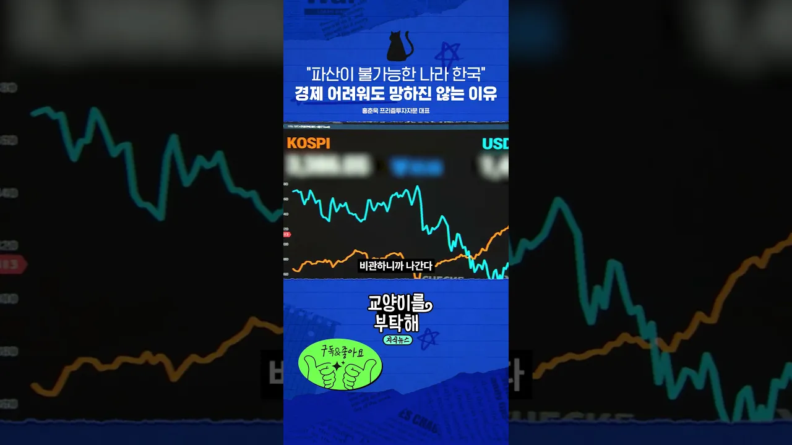

# "파산이 불가능한 나라 한국" 경제 어려워도 망하진 않는 이유 #교양이를부탁해

## 기본 정보
- **URL**: https://www.youtube.com/watch?v=sQcdUf5DveY
- **채널명**: 교양이를 부탁해
- **구독자수**: 49만
- **조회수**: 29,553
- **업로드일**: 2025-10-20
- **영상 길이**: 1:49
- **댓글 수**: 41
- **좋아요 수**: 331

## 썸네일

---

## 댓글 (추천순 TOP 10)

| 순위 | 좋아요 | 댓글 |
|------|--------|------|
| 1 | 9 | 떨어진다고 현금보유하래서 팔앗는데 포모증후군왔어요 |
| 2 | 1 | 네  패널 대표님의 의견에 동감 100퍼 합니다 |
| 3 | 5 | 노란봉투법을 맨드는걸 보고도 저런 소릴하네 |
| 4 | 1 | 청바지 누나 넘 귀엽지않나여😊 |
| 5 | 0 | 혹시 본인이세요? |
| 6 | 0 | 맞아요 넘 귀여움 사랑스러움 이뻐♡ |
| 7 | 0 | GDP 대비 3배 레버리지 하면 1.5배 정도의 외환은 순삭?😂😂😂 |
| 8 | 0 | 무료 일본변호사님들 논리에 따르면 맞지 ㅋㅋㅋ |
| 9 | 1 | ㅈ됐다.. 망하겠는데.. |
| 10 | 0 | 네... 하지만 우리나라 경제는 망하지 않습니다 |
