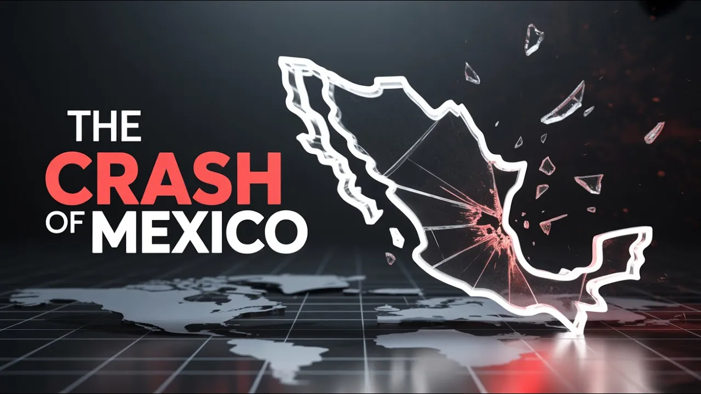

# The Peso Crash: The Day Mexico Went Bankrupt

## 기본 정보
- **URL**: https://www.youtube.com/watch?v=MS4ZwIyd3_A
- **채널명**: Financial Historian
- **구독자수**: 17만
- **조회수**: 13,363
- **업로드일**: 2025-09-08
- **영상 길이**: 10:25
- **댓글 수**: 45
- **좋아요 수**: 513

## 썸네일

---

## 댓글 (추천순 TOP 10)

| 순위 | 좋아요 | 댓글 |
|------|--------|------|
| 1 | 30 | im trying to quickly watch these all before you are outlawed for national security reasons |
| 2 | 3 | 😳😳😳 |
| 3 | 2 | This is why everyone should USE NOSTR |
| 4 | 1 | ​ @profk21 what's that? |
| 5 | 20 | Excellent no music buffoonery |
| 6 | 6 | We will learn the only way politicians can - the hard way. Every time. |
| 7 | 4 | The same is happening in our country the  U.S.A. Billions of dollars have left our country since 2022 and it's getting worse now 2025. |
| 8 | 4 | It happened in Ghana too |
| 9 | 9 | Value of a fiat currency = fiduciary trust level of the govt issuing the currency   If the currency can be taken away, either fully, or partially through devaluation by poor monetary and fiscal policy, then trust levels go down… |
| 10 | 4 | Precisely what is hapening with the dollar right now. Decades ago. When there was inestability in markets, the people of the world ran to buy dollars. Now since Trump took office, the dollar had lost 10% of its value and people run away to buy gold instead of dollars. They don't trust in his spoiled child economic policy. |
