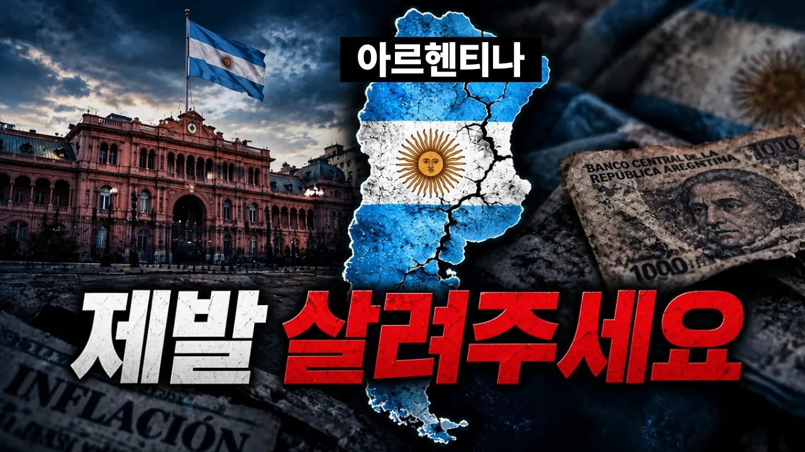

# 세계 5대 부국이었던 아르헨티나는 어쩌다 몰락했을까?

## 기본 정보
- **URL**: https://www.youtube.com/watch?v=qTv_1i4dA7Q
- **채널명**: 궁금소
- **구독자수**: 100만
- **조회수**: 11,991
- **업로드일**: 2026-10-12
- **영상 길이**: 15:19
- **댓글 수**: 55
- **좋아요 수**: 218

## 썸네일

---

## 댓글 (추천순 TOP 10)

| 순위 | 좋아요 | 댓글 |
|------|--------|------|
| 1 | 5 | 펼치는 순간 완독! 『지도는 답을 알고 있다』
 🌍 교보문고 http://product.kyobobook.co.kr/detail/S000221509431 
 🌍 예스24 https://www.yes24.com/product/goods/197205970
 🌍 알라딘 https://aladin.kr/p/9hVFZ |
| 2 | 19 | 우린 이 게임을 지금 하고 있어요~ |
| 3 | 26 | 이렇게 역사가 알려줘도 왜 모를까 그들은... |
| 4 | 0 | 그냥 정치도 그렇고 답도 없음 |
| 5 | 7 | 지금 아르헨티나 정책의 결과가 어떻게 나타날지가 매우 중요해보이네요 |
| 6 | 6 | 구독자 100만명 축하드립니다 👏 👏 |
| 7 | 6 | 이젠 메시까지 은퇴해서 답도 없네 |
| 8 | 24 | 요약 정리: 투표의 중요성 |
| 9 | 2 | 표를 세는 사람이 정함 |
| 10 | 2 | 투표를 잘해야한다고 하지만, 정작 우리가 할수있는건 그놈이 그놈인 판국에서 그나마 차악을 골라서 어떻게든 연명하는것 밖에 안된다는 느낌이 드는데 |
