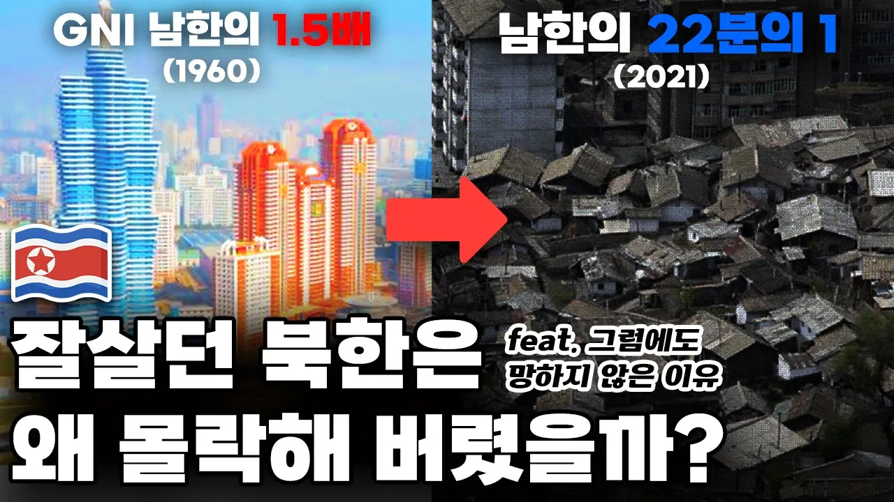

# 남한보다 잘살던 북한은 왜 최악의 빈곤국으로 몰락해 버렸을까?

## 기본 정보
- **URL**: https://www.youtube.com/watch?v=PpS8IRmEwtI
- **채널명**: 별별역사
- **구독자수**: 83만
- **조회수**: 8,796,007
- **업로드일**: 2023-02-07
- **영상 길이**: 19:47
- **댓글 수**: 8,100
- **좋아요 수**: 52,147

## 썸네일

---

## 댓글 (추천순 TOP 10)

| 순위 | 좋아요 | 댓글 |
|------|--------|------|
| 1 | 8,500 | 국민들이 열심히 한다고 되는 게 아니고 지도자가 잘 해야 한다는 걸 보여주는 대표적 사례. |
| 2 | 95 | 박정희 대통령 각하 |
| 3 | 127 | 박정희 대통령 각하 감사합니다.. |
| 4 | 138 | 박통과 산업역군 어르신들 아니였으면 우리는 여기 글 싸르지도 못했다 |
| 5 | 52 | 지원받았다고 다 성공한다? 그건 아닙니다. 남베트남, 아프칸, 필리핀이 성공했다고 평가받는 나라인가요? 남베트남에는 경우는 역사로 사라졌고 아프칸은 미군 철수 후 탈레반한테 정권을 빼았겼으며, 필리핀은 못 사는 국가라고 평가받죠. 왜 이들 국가가 실패했다고 보시나요? 그건 그 나라 국민들의 경제적 자립도/ 자유도가 떨어져서 그렇습니다.   베트남에 경우 냉전의 시대 속에서 오랜 내전으로 인해 인프라를 건설할 수 없었기에 인프라라는 게 없었죠. 그런데도 전쟁이 지속될 수 있었던 이유가 공산주의 진영에 북베트남의 지원, 자유민주주의 진영에 남베트남의 지원 덕분이었습니다. 남베트남의 경우는 정확하게는 자유민주주의를 수호하는 미국의 지원이라 보는 게 맞겠죠. 그렇지만 미국은 오랜 전쟁을 결국 포기하게 되는데, 그 결과 1년 후 남베트남은 적화 통일당하여 공산주의 국가가 됐죠. 그렇지만 남베트남의 경우는 힘을 키울 수 없는 현실이 이해가 되는 상황입니다.   아프칸은 911테러 이후 미국이 테러와의 전쟁의 명분을 앞세워 개입하게 됩니다. 그 사이에 미국에 보호와 원조로 인해 아프칸은 나름대로 평화가 지속됐죠. 하지만 20년이 지난 현재 미국이 아프칸의 문제 손을 때려 하고 미군철수를 강행하자 마자 아프칸에는 다시 탈레반 정권이 들어서게 됩니다. 이로 인해 바이든 정부가 비판받고 있죠. 그런데, 잘못한 거 잘못한 거지만, 왜 바이든 정부만 욕을 먹어야 할까요? 그 사이에 아프칸 정부는 뭘 했던 걸까요? 왜 스스로 힘을 키울 생각을 안하고 미국에만 의지했을까요? 베트남처럼 계속 전쟁이었던 상황도 아니었는 말이죠. 자립의지가 없는 나라에 무분별한 지원이 얼마나 위험한 지 알 수 있는 대목입니다.   필리핀에 경우 마르크스 정권이 장기 집권했죠. 마르크스 정권은 친미 정권이었기에 미국으로부터 지원을 많이 받았습니다. 그런데 마르크스는 지원받은 돈을 호텔이나 카지노 같은 곳에만 사용하고 부가가치를 창출할 수 있는 중공업에 투자하지 않았습니다. 또한 이 정권은 자신들의 사리사욕을 채우데에 급급했죠.   이제 우리나라의 얘기를 볼까요? 우리나라는 지원받고, 차관받고, 외화 벌어온 돈 인프라에 투자했습니다. 인프라가 생기니 국민들이 일을 할 수 있는 곳이 생기게 되고 경제적 자유도가 높아지게 됐죠. 또 세금내는 기업, 국민들이 많아지게 되니까 군사력도 키워질 수 있었던 겁니다. 부국강병이 이루어진 거죠. 부국강병이 되니 우린 베트남 전쟁, 테러와의 전쟁에서 미국을 도와줄 수 있었던 겁니다. 미국과 이제는 파트너가 된 거죠. 외교, 안보, 경제적 진보가 이루어진 것 아닙니까? 또 우린 정치적인 진보도 이뤘습니다. 잘사는 국민들이 권력을 견제할 수 있게 된 거죠. 이래서 박정희가 엄청나게 높은 평가받는 겁니다. 대단한 분이죠. 진짜.... 독재했다고 욕 먹는데, 전 이분 아니었으면 우리나라의 민주화가 이렇게 빠른 시일 안에 오지 않았었을 거라 장담합니다. 세계사를 봐도 민주주의는 그냥 오지 않았고 경제적 자유도가 생긴 국민들이 많은 나라일수록 성공하였습니다. |
| 6 | 12 |  @djtjrjdjdjdjdn  이렇게 빠삭한 분이랑 술 한잔 하면서 정치 경제 이야기 하면 시간 가는 줄 모르겠네요 |
| 7 | 2 |  @djtjrjdjdjdjdn  맞습니다. 김대중도 어쩔수없이 경제적 자유, 중산층이 많아야 민주화된다고 인정하였습니다. |
| 8 | 9 | 열심히는 아무나 다한다 잘하는게 중요한거지 물론 열심히도 안하는애들이 대부분이긴하지만… |
| 9 | 8 | 정확히는 이념과 지도자 |
| 10 | 12 |  @하이바이블러  그렇죠 이념, 정치체제.. 그런 것도 중요하죠. 그런 면에서 국가의 큰 틀을 자유민주주의 시장경제로 짜놓은 이승만이 있어서 박정희의 경제성장도 가능한 거고 우리나라 에너지 주권도 이승만이 원자력으로 진작부터 결정한 거고 경제발전 계획도 이승만 정권 때 마련한 것의 연장선상에서 이뤄진 부분이 많는데 박정희 대통령 업적에 대해서는 많은 분들이 실감, 공감하면서도 이승만 대통령의 역할에 대해서는 잘 알려져 있지 않은 거 같아요.   이후 전두환의 역할도 그렇고요.. 경제가 비약적으로 발전하고 꽃피운 것은 사실 전두환 때인데.. |
