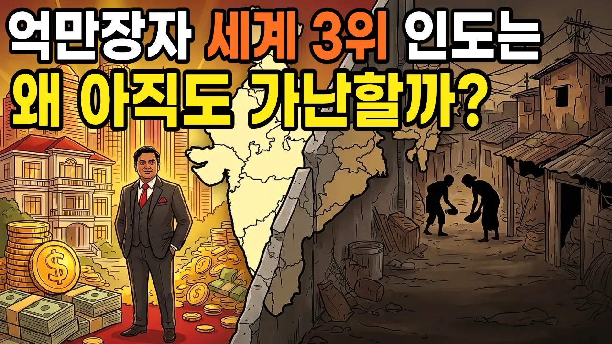

# "인도가 한국보다 잘살던 해" 60년 뒤 열네 배가 벌어진 이유

## 기본 정보
- **URL**: https://www.youtube.com/watch?v=75DwdeMslPE
- **채널명**: 인류의서재
- **구독자수**: 8만
- **조회수**: 27,375
- **업로드일**: 2026-10-10
- **영상 길이**: 20:56
- **댓글 수**: 2
- **좋아요 수**: 152

## 썸네일

---

## 댓글 (추천순 TOP 10)

| 순위 | 좋아요 | 댓글 |
|------|--------|------|
| 1 | 1 | 빈부차 엄청나네 ㅡㅡ |
| 2 | 0 | ** 인도의 계급 사회 구분	        전통적인 역할	   전통적 지위 브라만,,	성직자·학자	가장 높은 지위 크샤트리아,,	왕족·전사	두 번째 바이샤,,	상인·농업인	세 번째 수드라,,	노동·서비스 종사자	네 번째 달리트,,	다양한 직업 종사자	전통적 체계 밖에서 차별받음 |
