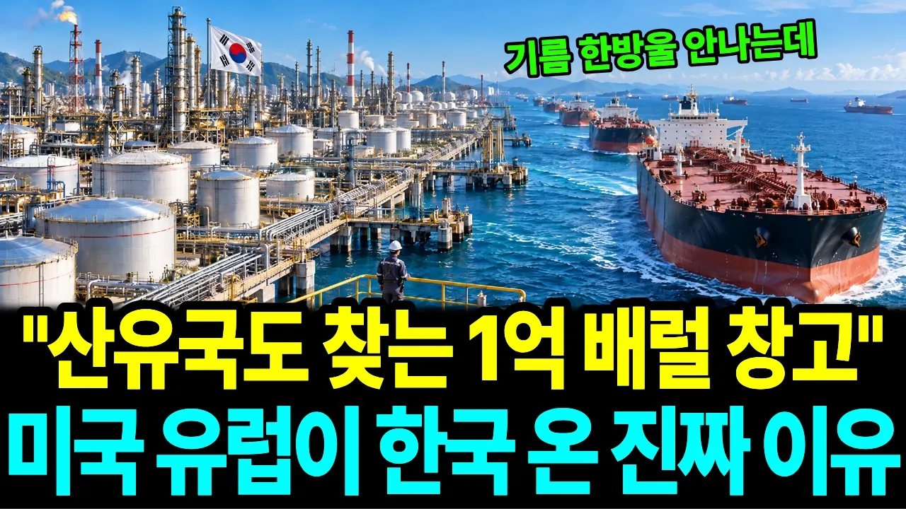

# 한국 정유공장, "원유는 있는데 기름이 없습니다" 1위 산유국 미국과 호주가 휘발유·항공유를 부탁한 이유

## 기본 정보
- **URL**: https://www.youtube.com/watch?v=nES7z7zrkhM
- **채널명**: 역전경제학
- **구독자수**: 402
- **조회수**: 81,560
- **업로드일**: 2026-10-21
- **영상 길이**: 24:36
- **댓글 수**: 14
- **좋아요 수**: 723

## 썸네일

---

## 댓글 (추천순 TOP 10)

| 순위 | 좋아요 | 댓글 |
|------|--------|------|
| 1 | 11 | 1973년 석유파동 때 한국은 미국 회사에서 원유를 줄이겠다는 통보를 받았어요.
 올봄엔 원유를 가장 많이 뽑는 미국과 호주가 거꾸로 한국에 기름을 부탁했죠.
 원유는 있는데, 그걸 기름으로 바꿀 공장이 모자랐던 거예요.
 기름은 땅이 아니라 공장에서 나온다는 걸 보여 준 장면이었어요.
 만 원어치 팔아 170원 남는 공장, 여러분이 사장이라면 계속 돌리셨을까요?
 이 이야기를 한 단어로 줄이면 뭐라고 하시겠어요? |
| 2 | 0 | 苦진甘來 |
| 3 | 8 | 정제유를 사러 한국오려면 빈 배로 오지말고 중동의 원유를 사다주면 안될까? |
| 4 | 4 | 흥미로운 생각이네요! 운송 효율까지 고려하면 충분히 궁금해질 만한 부분입니다. 좋은 의견 감사합니다. |
| 5 | 2 | 새로운 관점이십니다. 좋은 의견 주셔서 감사합니다~ |
| 6 | 1 | 통 씻을라믄? |
| 7 | 1 | 좋은 아이디어네요. 물류 효율도 함께 따져봐야겠네요. |
| 8 | 0 | 탱크 청소비는? |
| 9 | 0 | 원유가 왜없어,일본이 점령하고있는 우리7광구,미국의4배가 저장돼있어,일본이 50년째 압류하고있지~~~ |
| 10 | 1 | 정부의 역활이 얼마나 중요한지 알게된, 호르무즈사태입니다. 기름값을 못 잡았으면, 전체 물가에 엄청난 타격이 됬을 것 같군요 |
