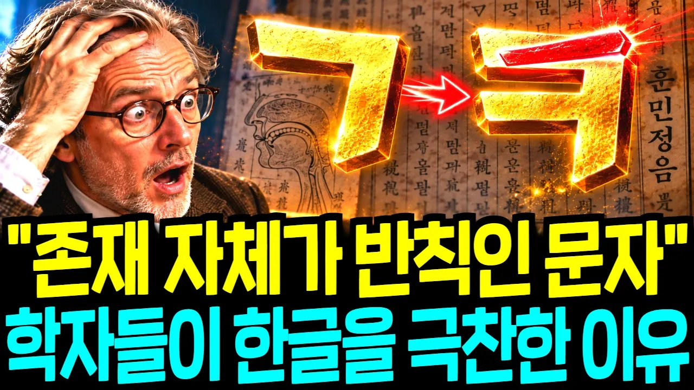

# "이 문자는 반칙 아닙니까?!" 전 세계 언어학자들이 한글에 고개를 숙인 진짜 이유

## 기본 정보
- **URL**: https://www.youtube.com/watch?v=o-5qsCCSVyo
- **채널명**: 우아한 경제
- **구독자수**: 901
- **조회수**: 281,930
- **업로드일**: 2026-10-26
- **영상 길이**: 30:13
- **댓글 수**: 122
- **좋아요 수**: 1,298

## 썸네일

---

## 댓글 (추천순 TOP 10)

| 순위 | 좋아요 | 댓글 |
|------|--------|------|
| 1 | 29 | 아들놈이 네살정도 되었을 때 저랑 같이 컴퓨터 자판을 가지고 놀다가 “글자가 이렇게  되는 거구나” 라고 말하던 순간을 사진을 찍은  것처럼 생생하게 기억하고 있어요, 정말 위대한 한글을 가진 우리나라는 축복입니다 |
| 2 | 2 | 그 정도면 그냥 님 아들이 굉장히 특출난 애인 거 같아요... 제가 직접 가르쳐 보고 싶네요.. 아니면 부모님께서 애초에 아예 해외대나 석박사까지 보내주셔야 할만한 재목일 것이라 생각 되는데... 착하고 옳은 길을 택하는 훌륭한 사람으로 잘 키우시기를 축원하옵나이다❤ |
| 3 | 1 | 세계 석학들이 놀랍다고 인정 하는 이유느 현 한글도 놀랍지만 초기본 해레본에 저놀라는 고대 5000년 이전의 고대문자와 유사하기 때문에 같다 라고도 할수 있는 |
| 4 | 0 | 근데 왜 외래어가 이리 판을 치나요? 왜래어가 정서에 더 잘어울리기 때문 아니까요? |
| 5 | 1 | ​ @ceejay4504  착각을 단단히 하는게 외래어,순우리말,한자어 등을 나눌필요가 없음 한글은 소리,말을 거의  그대로 옮겨적을 수 있는 문자라서 가능한거임,우리말과 한글은 서로 다른 개념인데 한글날만 되면 영어안쓰는 게임을 한다던가 하는건 아직도 말과 문자를 이해 못하는거, 참고로 언어란 뜻은 말과 문자,소통의 수단이란 뜻임, 모르는 사람많음 우리의 언어가 이렇게 바뀐건 한글덕분임 그냥 감사하게 쓰면 됨 |
| 6 | 8 | 송알 송알 싸리잎에 은구슬~ 대롱대롱 풀잎마 송송~ 이렇게 아름다운 말 나타낼수 글자는 한글 뿐입니다. |
| 7 | 3 | 우리가     자랑스러운    우리말을    축햐하지   않았는데 다른이들이    축하하는    날을 만드니    실로     자부심이 절로나는구나, |
| 8 | 7 | 당신의 영상이 현대판 한글 창제 해례본 입니다. 잘 들었습니다.🫰 |
| 9 | 4 | 너무 자랑스럽다 이렇게 편히 댓글을 달수 있다는걸 |
| 10 | 0 | "편히"라는 말은 자유대한민국이였기 가능한 거지. 조선시대나 일제나 조선민주주의 인민독재국가에서는 불가능하다. 국부인 이승만 대통령에게 감사해야지. |
