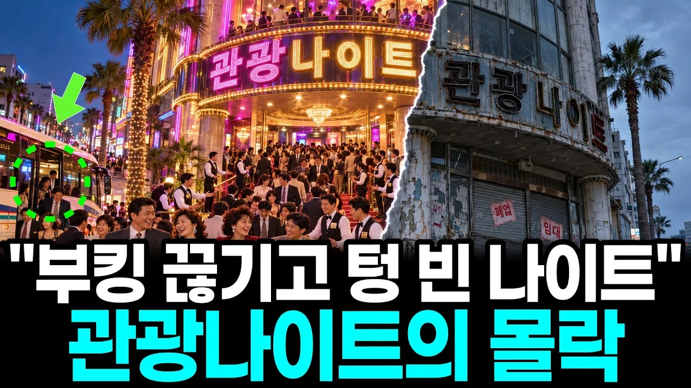

# "춤추기 싫어진 게 아닙니다" 웨이터만 100명이던 관광나이트가 하나둘 사라진 진짜 이유

## 기본 정보
- **URL**: https://www.youtube.com/watch?v=UXophgfdByc
- **채널명**: 경제팀장
- **구독자수**: 1,420
- **조회수**: 193,935
- **업로드일**: 2026-10-27
- **영상 길이**: 18:35
- **댓글 수**: 64
- **좋아요 수**: 656

## 썸네일

---

## 댓글 (추천순 TOP 10)

| 순위 | 좋아요 | 댓글 |
|------|--------|------|
| 1 | 50 | 먹고살기 힘들어지면 연애도 안하고, 결혼도 안하고, 출산도 안하고... 당연한 결과입니다. |
| 2 | 6 | 주 웨이터 있고 보조웨이터 있는데, 주웨이터 팁주면 다시 보조웨이터 데려와서 팁달라고 꼽주는 문화. 소득은 없고 주머니만 개털리는 무한 반복 구조 |
| 3 | 15 | 물가의 안정이 돼야 되고 이런 술집도 80년대 70년대 이런 식의 값싼 내용이 나와야 되는데 너무 하늘을 찌르듯이 비싸다. 누가 가겠는가? 경제 원리에 맞게 운영을 해야 되는 거다. |
| 4 | 10 | 나이트클럽, 클럽 한창 붐일때 즐길수 있어서 좋았다. 이젠 다 추억이네 |
| 5 | 12 | 요즘 어쩐지 나이트가 많이 안보이더라.나도 마지막으로 가본게 26년전인거 같네요. |
| 6 | 3 | 시대가 변하네요. 잘 보고갑니다. ❤❤🎉 |
| 7 | 13 | 돈많은 인간들이.돈을 풀어야. 서민들이 돈을 써서 경제 선순환이 된다 돈많은 사람들은 해외나가 돈을 쓴다 한국은 관광지는 죽었다 |
| 8 | 15 | 먹고살기 힘드니 |
| 9 | 3 | 지금,,     춤출  젊은이들이  없다 지금은  모두가 __  돈)  돈)   돈) 재테크)  재테크)   재테크) |
| 10 | 3 | 코로나전과 후의 세상 |
