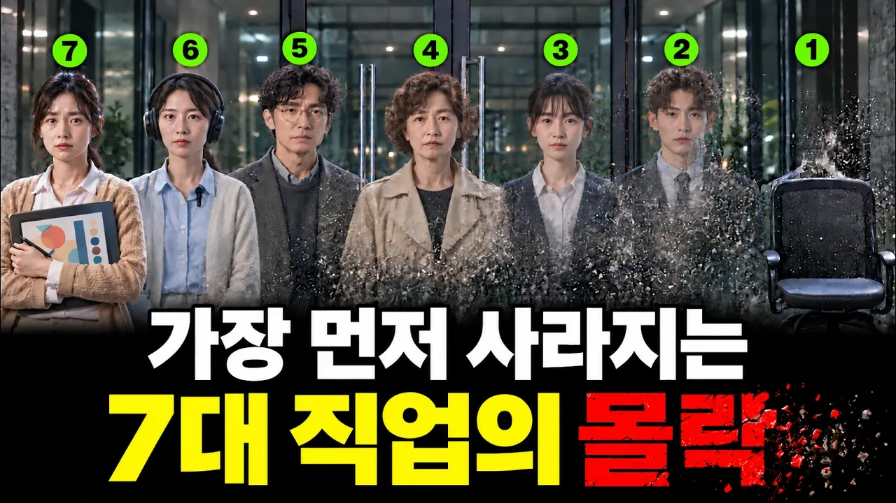

# "1위는 아무도 예상 못 했습니다" 지금 한국에서 가장 빠르게 사라지는 직업 TOP7

## 기본 정보
- **URL**: https://www.youtube.com/watch?v=JsRcJHgR16M
- **채널명**: 경제히어로
- **구독자수**: 2,460
- **조회수**: 516,691
- **업로드일**: 2026-10-21
- **영상 길이**: 19:46
- **댓글 수**: 92
- **좋아요 수**: 1,637

## 썸네일

---

## 댓글 (추천순 TOP 10)

| 순위 | 좋아요 | 댓글 |
|------|--------|------|
| 1 | 95 | AI가 이렇게 발전한다면 판사부터 없어져야 하는거 아닌가 ... |
| 2 | 4 | 맞아요 |
| 3 | 3 | 공무원부터 |
| 4 | 1 | AI보다 위는 권력이야 |
| 5 | 80 | 판사 국회의원부터 줄여라 |
| 6 | 0 | 국회의원 고위공무원은 안 없어짐. 이익이 얽히는 곳이고 거버넌스마저 AI에 넘어가면 그건 진정 인간존재의 의미를 찾아야... |
| 7 | 52 | AI로 가장 시급하게 대체해야 할 직업은 판사입니다. AI는 법과 판례도 무궁무진 알고, 조서, 증언, 증거 등을 정확하게 분석하여 유, 무죄를 판단하고 형량을 엄정하게 결정할 수 있습니다. 24시간 365일 재판 가능하고 공정성 시비도 없습니다. 월급 줄 필요도 없고 사무실도 필요없습니다. 격려금 같은 거  안줘도 되고 오마카세 안먹여줘도 됩니다. |
| 8 | 6 | 최고 |
| 9 | 18 | 대학갈  필요가 없고  전기, 배관, 용접 3종 세트 배우고  현장 뛰면 천하무적 |
| 10 | 0 | 연봉 10억 하나요? |
