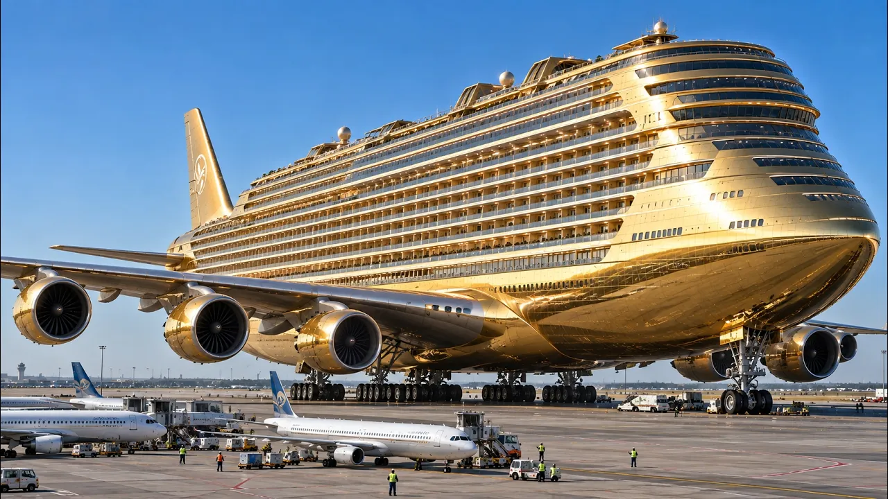

# Un Avión de 445 Millones de Dólares — ¿Qué Hay Dentro de Este Gigante de Lujo?

## 기본 정보
- **URL**: https://www.youtube.com/watch?v=Gr42InTpG60
- **채널명**: Umbral del Saber
- **구독자수**: 2만
- **조회수**: 5,907,016
- **업로드일**: 2026-10-01
- **영상 길이**: 22:42
- **댓글 수**: 454
- **좋아요 수**: 24,738

## 썸네일

---

## 댓글 (추천순 TOP 10)

| 순위 | 좋아요 | 댓글 |
|------|--------|------|
| 1 | 17 | Prefiero bañarme en mi casa antes del vuelo 😮😮😮😮 y al llegar a destino !!! |
| 2 | 47 | Yo hice un viaje en un avión como este una noche que me dio x soñar y soñar hasta despertar y darme cuenta que todo era un suño😟 chao👋👋👋😭 |
| 3 | 147 | Viajé con este avión desde Buenos Aires  a Londres, con escalas en Rio de Janeiro y Dubai. Fue un vuelo larguisimo,  pero el más placentero. Creo que el transporte aereo debería ser una de las maravillas modernas. |
| 4 | 3 | Вы ещё на дирижабле не летали 🤣 |
| 5 | 2 | 꿈에서 타봐야겠엉 |
| 6 | 1 | Totalmente de acuerdo! La aviación es una maravilla de la ingeniería. Poder viajar entre continentes con tanta comodidad es algo increíble. |
| 7 | 1 | Za twoje przyjemne loty płacą zwykli ludzie zmuszani do ekologicznego zużywania energii i wody. |
| 8 | 1 | Totalmente de acuerdo |
| 9 | 9 | J'ai bien aimé cet avion et son confort, suite à un voyage que j'ai fait de Londres à syngapore et de singapore à ❤❤Sydney c'était magique. |
| 10 | 7 | E chi se ne frega |
