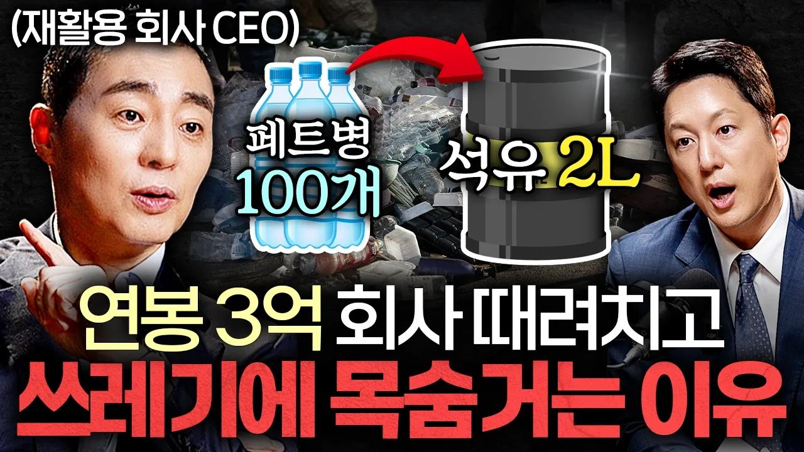

# 2000억 기업 회장님이 15년째 같은 옷만 입는 이유ㅣ지식인초대석: CEO EP.4 (수퍼빈 김정빈 대표)

## 기본 정보
- **URL**: https://www.youtube.com/watch?v=ea2pq5eeft8
- **채널명**: 지식인사이드
- **구독자수**: 411만
- **조회수**: 56,465
- **업로드일**: 2026-07-05
- **영상 길이**: 48:43
- **댓글 수**: 145
- **좋아요 수**: 1,126

## 썸네일

---

## 댓글 (추천순 TOP 10)

| 순위 | 좋아요 | 댓글 |
|------|--------|------|
| 1 | 13 | 📌06:54 대한민국 석유 의존도를 대체할 미래 산업
 
 00:00 인트로
 00:28 구독자 인사
 00:43 쓰레기 주워 수백억 버는 수퍼빈, 어떤 기업일까
 02:43 석유를 대체하는 쓰레기? 자원 국산화의 가능성
 05:34 페트병 라벨 재활용이 현실적으로 어려운 이유
 06:54 대한민국 석유 의존도를 대체할 미래 산업
 08:41 제로 웨이스트 시대, 대한민국 재활용의 현주소와 경쟁력
 11:21 “아수라 지옥이다” 우리나라 재활용 선별장의 현실
 14:38 쓰레기를 돈으로 바꿔주는 인공지능 AI 로봇
 17:14 재생원료 페트병 대체가 현실적으로 어려운 이유
 20:36 기업가치, 2,500억 원의 수퍼빈, 시장이 베팅한 미래 가치
 24:34 환경계 노벨상 ‘어스샷’ 최종 후보 이후 수퍼빈의 새로운 목표
 28:36 중견기업 3억 연봉 포기하고 창업을 결심한 이유
 30:04 대기업 출신 창업가들이 의외로 성공하기 어려운 이유
 32:45 창업 초기 수퍼빈이 투자자의 마음을 연 비결 ‘2가지’
 35:56 창업은 확신이 아닌 ‘이것’을 가지고 시작해야 합니다
 39:00 착한 기업이 아닌 ‘돈을 버는 기업’이라 말하는 이유
 44:13 연 매출 190억 대표가 15년째 같은 옷 입는 이유
 46:25 창업을 망설이는 청년들에게 건내는 조언 한 마디
 
 *본 영상은 26년 6월 18일 촬영되었습니다.
 
 📌주변에서 네프론을 발견한 적이 있다면 댓글로 여러분의 경험을 공유해주세요! |
| 2 | 44 | 재직자 입니다... 어짜다 보니 와이프랑 나란히 앉아서 감명깊게 보았습니다. 대표님과 대화를 나눌 일은 없었지만, 각자의 위치에서 모두 화이팅 입니다^^ |
| 3 | 7 | 오! 우리 수퍼빈 크루의 댓글이라니!! 감사해요. 😊 |
| 4 | 69 | 안녕하세요 한석준입니다.  패트병 쓰레기를 모아서 다시 새로운 제품을 만들 수 있다면? 공상과학 영화에 나올 것 같은 이야기를 실제로 실천해내는 사람이  있습니다. 수퍼빈의 김정빈 대표는 무슨 생각을 하면서 어떤 일을 해내려고 하는걸까요? 우리 생활의 편의를 위해 플라스틱을 안 쓸 수는 없겠지만 플라스틱 쓰레기가 줄어들 날을 꿈꿉니다. |
| 5 | 4 | 미국에서는 페트병으로 신발 만드는 회사 있어요. 한국 백화점에 입점 한걸로 알아요. 모두들 대단 하십니다.. 👏👏👏 |
| 6 | 5 | 진짜 이번 인터뷰는 느껴지는 바가 너무 많았던 것 같습니다. 그냥 이 말이 저절로 나오네요. 존경합니다. 감사합니다. |
| 7 | 37 | 누군가  해야 할 일을 해주셔서  감사합니다. 투자해 주신분들도 감사합니다. |
| 8 | 3 | 투자자분들도 님과 같은 말씀을 해주세요. 누군가는 이 문제를 풀어야 한다. |
| 9 | 21 | 김정빈 대표님, 개인적으로 알고 지낸지 12년이 되었네요. 이 분의 진정성과 열정에 홀딱 반할 수 밖에 없죠. 그리고... 슈퍼빈 아님^^ 수퍼빈!! |
| 10 | 1 | 수퍼빈! 😆 |
