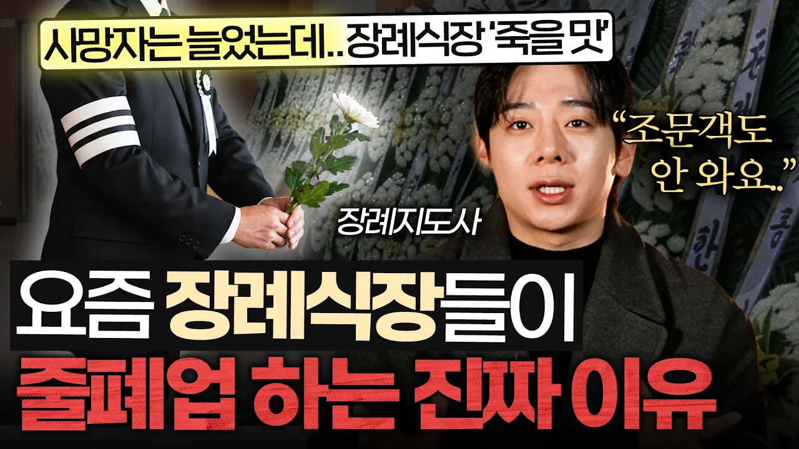

# 부모님 장례, 무빈소 1일장 했더니 생기는 충격적인 변화 (김범진 장례지도사)

## 기본 정보
- **URL**: https://www.youtube.com/watch?v=vMOFmCaMjBs
- **채널명**: 지식인사이드
- **구독자수**: 411만
- **조회수**: 874,476
- **업로드일**: 2026-02-20
- **영상 길이**: 17:48
- **댓글 수**: 1,100
- **좋아요 수**: 13,196

## 썸네일

---

## 댓글 (추천순 TOP 10)

| 순위 | 좋아요 | 댓글 |
|------|--------|------|
| 1 | 268 | 📌 01:28 천만원 넘는 3일장 대신, 무빈소 장례가 늘어나는 이유 
 
 [타임스탬프]
 00:00 인트로
 00:17 자기소개
 00:25 사망자는 역대 최대인데.. 장례식장은 줄줄이 문닫는 이유
 01:28 천만원 넘는 3일장 대신, 무빈소 장례가 늘어나는 이유 
 03:32 무빈소 장례 할 때, 가족끼리 '이것'부터 정하세요 
 04:31 부모님 돌아가셨을 때, 119부터 부르지 말라는 이유
 05:37 매번 헷갈리는 장례 절차, '이렇게' 대처하세요
 07:06 젊은 사람들이 가장 많이 실수하는 장례식 예절 
 09:38 장례식장에 가지고 오면 안되는 물건  
 10:51 조의금 vs 부의금, 3분안에 구분하는 법  
 11:54 8년차 장례지도사의 잊을 수 없는 장례식 
 14:23  장례지도사가 ‘안녕하세요’ 라는 말 안 하는 이유 |
| 2 | 2 | 😊😊😊😊😊😊😊😊😊😊😊😊😊😊😊😊 |
| 3 | 1 | 44 |
| 4 | 2,700 | 결혼식도  가족만으로 하는 문화로 바뀌어야한다. 무빈소 대환영합니다. |
| 5 | 3 | 반가운소식 이네요 |
| 6 | 20 | 시대의 흐름에 맞게 바뀌어야지 예법 어쩌구 할거면 조선시대 성리학 예법대로 3년상 치르고 예송논쟁 해라 |
| 7 | 1 |  @hcj8707  맞는 말씀이네요,,, 어차피 예법이란 시대에 맞줘 가는것이니.. 1인가족이 늘어나고 삼촌 고모가 없어지는 상황에서 이제 1일장으로 변모될 가능성이 클듯하네요 |
| 8 | 8 | 이 문제로 부모님들과 싸우는 자녀들도 많음. 부모님들 미리 아시면 서운해하심. |
| 9 | 14 |  @콰지-q9m  저는 아버지 유언이 무빈소였습니다 큰집에도 알리지 말라고 하셨고 그래서 저같은경우 화장까지 다해서 360정도 들어갔습니다 |
| 10 | 2 |  @콰지-q9m  ㅋㅋㅋㅋㅋㅋㅋㅋㅋㅋㅋㅋㅋㅋㅋㅋ 뭐 어차피 국토 전체를 아파트 천지로 만들었는데 무슨 장례식이야. 걍 화장장으로 빠르게 가 |
