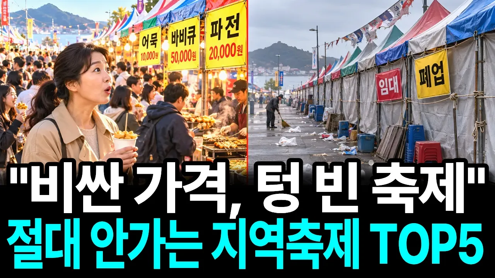

# "바가지 때문인 줄 알았습니다" 수백만 명 찾던 대한민국 대표 축제들이 통째로 사라진 진짜 이유

## 기본 정보
- **URL**: https://www.youtube.com/watch?v=7Gjl1M2CzKg
- **채널명**: 경제상담소
- **구독자수**: 3만
- **조회수**: 335,437
- **업로드일**: 2026-10-18
- **영상 길이**: 25:27
- **댓글 수**: 164
- **좋아요 수**: 1,647

## 썸네일

---

## 댓글 (추천순 TOP 10)

| 순위 | 좋아요 | 댓글 |
|------|--------|------|
| 1 | 16 | 여러분은 최근 다녀온 지역 축제 중에서 "여긴 진짜 다시 가고 싶다!" 싶었던 곳이나, 반대로 "예전만 못해서 아쉬웠다" 느꼈던 곳이 있으신가요?
 
 시청자분들의 생생한 축제 경험과 솔직한 생각을 댓글로 들려주세요! 💬 |
| 2 | 0 | 서천 수산물축제, 광어축제 진짜 별로였어요 |
| 3 | 0 | 횡성한우축제 대성공이라생각됨. 내년도후년도 3~4박하면서  보리라~~ |
| 4 | 2 | 군산짬뽕축제. 음식이 맛있었고 바가지가 없었고 유명 연예인 없이도 공연도 정말 신났음. 내년 친구들 싹 모아서 이번에 하루 갔는데 2일 갈 것임 |
| 5 | 1 | ​​ @sarahjo3003  전 군산의 토박이인데 2천년대 중반에 주꾸미축제가 있어 가봤는데 음식값이 넘 비싸 발길을 돌린적이 있었습니다  그후 사람들의 발길이 끊어지니 축제자체가 없어졌죠  바가지 상혼때문에.. 그후로 신설된 축제가 시간여행축제와 짬뽕축제죠 |
| 6 | 91 | 지역민들 세금으로 연예인 배 불리는것 |
| 7 | 76 | 세금을 축내는 지역 축제를 모두 없애야한다. |
| 8 | 112 | 연예인들  배불리는 지역축제 그만핮ㄱㆍ |
| 9 | 103 | 지역축제는 세금으로 정치하는것들 홍보하는것. |
| 10 | 44 | 어느 축제 던지 결과는 바가지 쓰는 곳 입니다 , 거기 에서는 무조건 돈 쓰지 말아야... |
