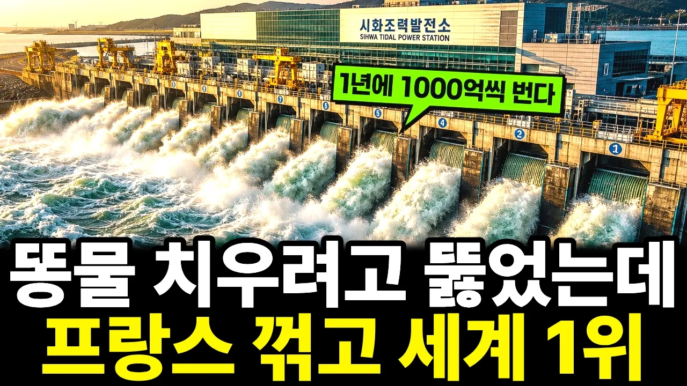

# “실패를 인정하는 순간 기적이 시작됐다” 대한민국 역사상 가장 거대했던 실패가 세계 1위 신화가 된 이유

## 기본 정보
- **URL**: https://www.youtube.com/watch?v=S-H5Q7Cqx14
- **채널명**: 이상하TV
- **구독자수**: 1만
- **조회수**: 153,004
- **업로드일**: 2026-10-21
- **영상 길이**: 25:39
- **댓글 수**: 25
- **좋아요 수**: 1,235

## 썸네일

---

## 댓글 (추천순 TOP 10)

| 순위 | 좋아요 | 댓글 |
|------|--------|------|
| 1 | 21 | 위기를 기회로...조력 발전소 만든 분들 수고 많으셨습니다.  대한민국 흥해라 ~ |
| 2 | 16 | 60년대 울산공단 태화강이 그랬었고, 광양만이 그랬으며... 60년대까지 물놀이를 했던 중랑천에도 간장 빛 강물이 흘렀는데... 강변 무 배추 밭에 이 물을 뿌리면... 무 배추가 말라 죽었다. 그리고 물에 빠진 사람이 피부병에 시달릴 지경이었다. |
| 3 | 12 | 코리아는 모든 분야에서 최고가 되길 원한다~ |
| 4 | 11 | 시화호는 서해 섬들이 많으니 남쪽에서 위로 밀려오는 파도가 이 섬들에 막혀 9m 높이차이가 나고, 남해안이나 동해안은 3m. |
| 5 | 9 | 감동 입니다. |
| 6 | 5 | 에전에.. 시화호 지나면 냄새가... 안산에 사는 시민들이 불쌍하게 생각했던.. 😂 에전 그분들이 보상같은 일이 생겼네요 😊 |
| 7 | 6 | 와~~ 이 싸이트 구독하길 잘 했넹~ .대박나세요. |
| 8 | 0 | 구독해 주셔서 정말 감사합니다! 영상이 마음에 드셨다니 힘이 나네요, 앞으로도 좋은 이야기로 찾아뵐게요 😊 |
| 9 | 1 | 대한민국 만만세 쭈욱쭉 대박나길  간절히 기도합니다 |
| 10 | 32 | 저 당시 시화호 담당 공무원들은 적어도 양심과 열정이 있었네. 군산 새만금 잼버리 공무원들은 세월 탓이야 아니면 지방 탓이야? |
