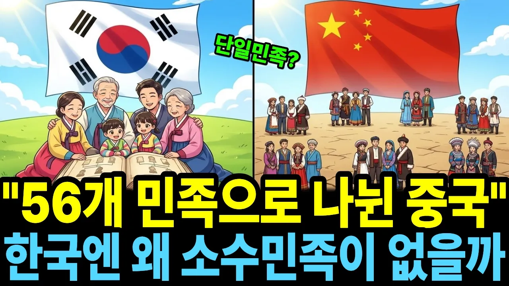

# 중국은 56개 민족인데, 천 년 동안 이방인을 받아들인 한국은 왜 소수민족이 없을까

## 기본 정보
- **URL**: https://www.youtube.com/watch?v=dtlNeBczpjk
- **채널명**: 경제학일번지
- **구독자수**: 1,680
- **조회수**: 82,631
- **업로드일**: 2026-10-19
- **영상 길이**: 29:10
- **댓글 수**: 63
- **좋아요 수**: 371

## 썸네일

---

## 댓글 (추천순 TOP 10)

| 순위 | 좋아요 | 댓글 |
|------|--------|------|
| 1 | 6 | 백인이던 흑인이던 한국인과 결혼해 손자대까지 오면 외모상 구별도 없어지지. |
| 2 | 8 | 내가 태초 부터 한국인이 따로 있냐,,오다 가다 한국에 정착해서 살면 한국인 이지 |
| 3 | 3 | 우린 조선지역(평양) 삼한지역(한반도 중남부)에서 살던 사람들이 서로 어울려서 비슷한 사람끼리 모인 집단입니다.  민족이라기보다 같이산 종족이죠. 유전적으로 민족으로 분류하려면 애매합니다. |
| 4 | 1 | 인류학에서는 한반도를 
 여러 인종/민족이 
 하나의 도가니(용광로)에서 녹아 융합되었다는 뜻으로
 유전적 도가니(Melting Pot)라고 표현하기도 합니다
 
 
 🟩제미나이의 대답
 형질인류학과 분자유전학의 관점에서 한반도는  오랜 시간에 걸쳐 다양한 집단이 융합된 ‘유전적 도가니(Melting Pot)’가 맞습니다.  우리가 흔히 교육받아온 ‘순수 단일민족’이라는 관념은  과학적 사실보다는  근대 국가 형성 과정에서  결속력을 높이기 위해 만들어진  문화적·정치적 신화에 가깝다는 것이 현대 인류학계의 공통된 의견입니다.
 
 1. 유전인류학이 밝혀낸 한반도의 ‘융합’
 
 현대 한국인의 게놈(Genome) 분석 결과에 따르면, 
 한국인의 혈통은 결코 하나의 단일한 뿌리에서 나오지 않았습니다.
 • 남방계와 북방계의 결합: 
 한국인은 약 수만 년 전 동남아시아에서 유래해 
 시베리아 등 북아시아로 퍼진 선남방계(북방계 직계 조상) 집단과, 
 약 3,500년 전 남중국 지역에서 동아시아로 급격히 확산한 후남방계 집단이 
 한반도라는 공간에서 수천 년간 복잡하게 섞이며 형성되었습니다.
 • 동아시아 교차로로서의 한반도: 
 지리적으로 한반도는 대륙 세력(몽골, 만주, 한족)과 
 해양 세력(남방계, 왜)이 끊임없이 오고 가며 충돌하고 교류하는 통로였습니다. 
 전쟁, 이주, 무역을 통해 수많은 혈통이 섞여 들어왔고, 
 그것이 오랜 세월 동안 '도가니'처럼 녹아들어 지금의 한국인이라는 유전적 집단을 이룬 것입니다.
 
 2. '인종의 도가니'와 '단일성'의 역설
 
 그렇다면 왜 우리는 유전적으로 섞여 있음에도 
 외부적으로는 하나의 단일민족처럼 보일까요? 
 여기에는 인류학적인 이유가 있습니다.
 • 높은 동질성의 이유: 
 수천 년 전 다양한 뿌리에서 온 인구 집단이 한반도에 정착한 이후, 
 지리적 격리(삼면이 바다)와 오랫동안 유지된 통일 왕조(신라·고려·조선) 체제 속에서 
 폐쇄적으로 통혼(Intermarriage)이 이루어졌습니다. 
 그 결과, 초기의 다양했던 유전자들이 골고루 섞여 
 현대에는 세계에서 유전적 동질성이 가장 높은 집단 중 하나가 되었습니다.
 • 문화적 용광로: 
 인류학자들은 한반도가 단순히 피만 섞인 것이 아니라 
 언어(한국어)와 문화, 역사적 경험을 공유하며 
 '한국인'이라는 강력한 공동체 정체성을 제련해 낸 
 성공적인 '문화적 용광로'였다고 설명합니다.
 
 3. 현대 대한민국과 새로운 '도가니'
 
 오늘날 인류학이나 사회학에서는 과거의 유전적 융합을 넘어, 
 실질적인 다인종·다민족 사회로의 진입 맥락에서 이 용어를 다시 사용하고 있습니다. 
 저출산과 이민자 유입으로 인해 
 대한민국은 빠르게 다문화 사회로 전환되고 있으며, 
 이제는 혈통적 단일성이 아닌 
 문화적 포용력을 시험받는 진짜 의미의 '도가니'가 되어가고 있습니다.
 
 
 한반도의 인류학적 기원에 대해 더 알고 싶으신 부분이 있으신가요?
 • 고대 유전자 분석을 통해 본 한국인의 하플로그룹(부계/모계 유전자) 특징
 • 역사 속에서 한반도로 유입된 귀화 성씨나 이주민의 역사
 • 현대 한국 사회가 마주한 다문화·다인종 사회로의 이행과 갈등
 관심 있는 주제를 말씀해 주시면 관련 연구 내용을 더 자세히 소개해 드리겠습니다.
 
 AI 대답에는 오류가 있을 수 있습니다. 자세히 알아보기
 
 . |
| 5 | 1 | 땅덩어리 크기가 중국의 한개 성 크기도 안되니 쪼개질 공간이 어디있나. |
| 6 | 0 | 해방 전후  두만강 유역 함경도 여진 만주족 많이 살았다고 합니다 ... 6.25전쟁 이후 북조선화 정리 |
| 7 | 2 | 월성 김가유. |
| 8 | 2 | 소수민족은 대부분 선주민 집단  혹은 원주민들이 침입한 집단에게 밀려나  험지로 숨어들어 살면서 생겨납니다  한반도에도 만여년 전부터 원주민 혹은 선주민 집단이 존재했습니다  일본도 중국도 마찬가지였죠  중국은 한족들이 선주민을 밀어내는 과정에서 묘족들과 같은 소수민족이 생겨났고 일본도 아이누족을 북쪽으로 밀어내면서 국가를 만들었습니다  중국 일본의 건국신화는  정복 정벌 과정이 기본 스토리입니다  보통 마귀 악귀등으로 묘사되죠  우리나라의 경우는 좀 다릅니다  청동기 철기 집단이 한반도로 밀고 들어왔지만 원주민들을 밀어내지 못했습니다  한반도 지형이 참 웃긴게 맘만 먹으면 방어에 유리하거든요  결국  침입한 집단은 정복 혹은 밀어내기를 못하고 타협하는 형식으로 정착했습니다  건국신화를 보면 사람이된 곰과 결혼하거나 6개의 마을 촌장들이 추대하거나 데려와서 보살폈다느니  기존 정주민들이 버젓이 창업자들을 받아들이는 형식을 보입니다  즉 밀어내고 쫓아내고가 아닌  결혼이든 추대를 하든 타협하고 합치는 방식으로 침입한 자들과 융합했습니다  요약하면  일만년전부터 돌창들고 사냥 다니던 선주민들의 혈통이 단절되지 않고 현재 한국인 핏줄의 뼈대를 이루고 있는거고 그때문에 소수민족이 있을수가 없는겁니다  보통 다른지역은 선주민들을 몰살 시키거나 밀어내거나  하거든요  예를 들면 스톤헨지를 만들던 시대의 유럽인들과 현재 유럽인들은 아예 혈통이 다릅니다  한반도가 특이한 케이스죠 |
| 9 | 1 | 재가승 이라고 불리었던 사람들 이야기가 아쉽네요. 해방전까지 함경도 두만강 지역에는 재가승이라는 사람들이 살았지요. 여진족 이라는 말이 있습니다. 이 사람들의 이야기는 1930년대 조사에는 4천명 정도였다고 하지요. 김동환의 국경의 밤이라는 시에도 재가승이 등장하지요. 1957년 북한의 조사에도 1000호가 넘게 잔존했었다는 기록도 있지요. 하지만 1960년대 북한의 동화정책에 따라 소멸했습니다.  한반도 내에 잔존했던 풍습과 말이 달랐던 재가승 사람들의 이야기가 아쉽네요. |
| 10 | 0 | ㄴ 한국인이 외부 세력에 대한 그만큼 배타적이고 폐쇄적이라는 겁니다. |
