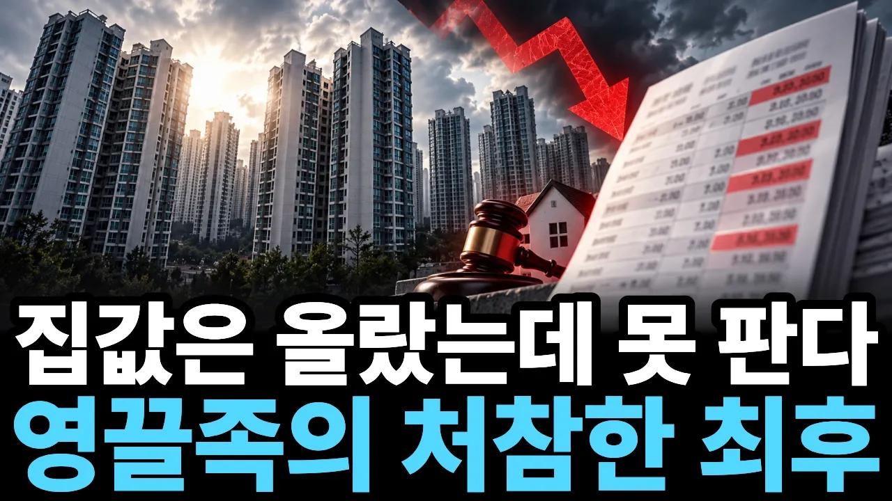

# "집값은 올랐는데 못 팝니다" 빚만 남은 영끌족의 충격적인 최후

## 기본 정보
- **URL**: https://www.youtube.com/watch?v=nt1SkU2TMe8
- **채널명**: 머니프렌즈
- **구독자수**: 4,300
- **조회수**: 174,569
- **업로드일**: 2026-10-18
- **영상 길이**: 21:02
- **댓글 수**: 162
- **좋아요 수**: 695

## 썸네일

---

## 댓글 (추천순 TOP 10)

| 순위 | 좋아요 | 댓글 |
|------|--------|------|
| 1 | 19 | 돈은 욕심내면 멀어짐 |
| 2 | 12 | 집값 오른만큼이 다 빚이야~ |
| 3 | 10 | 이자때문에 집판다는 사람을 못봄 |
| 4 | 46 | 영끌수요가집값을 밀어 올렸음.  돈도 없었는데. 은행에서 처음 낮은 금리로 대출을 마구 해주었으니 돈도 없는 사람들이 여기저기에서 뛰어들어 집을 삶 지금처럼만 진즉 대출을 안해 주었더라면 집값 문제가 이렇게 안 되었으텐데 ....  지금 늦었지만 대출 이자라도 팍팍 올려라 |
| 5 | 0 | 오늘도 거짓선동언론은 서민에게 대출( 은행노예로 살게 해야한다고)더 해줘야한다고 서민 사다리 끊어졌다고 매일 방송하고 부동산상승론자들도 유투브에 나와서 이재명정권이 대출제한정책을 미친듯이 공격 하던데 |
| 6 | 35 | 은행의 성과급잔치의 제물들이여... |
| 7 | 13 | 보수 언론들이 집값이 최고치라고 하는데 집 경매 물건도 최고치다... 아이러니하네....그냥 집값을 내려 팔았으면 경매는 당하지 않았을텐데... |
| 8 | 7 | 많이 올라서 기분 좋겠다 |
| 9 | 50 | 영끌족이 문제인거지, 유주택자들은 돈 벌었지 뭐 |
| 10 | 20 | 수익은 팔고 이익을 내야 나오는거지.. 집값 오른건 좋지만 그만큼 재산세 종부세도 늘고 윗동네로 갈아타기하려고해도 갭이 커져서 딱히 돈 벌었다는 느낌은 안듦.. |
