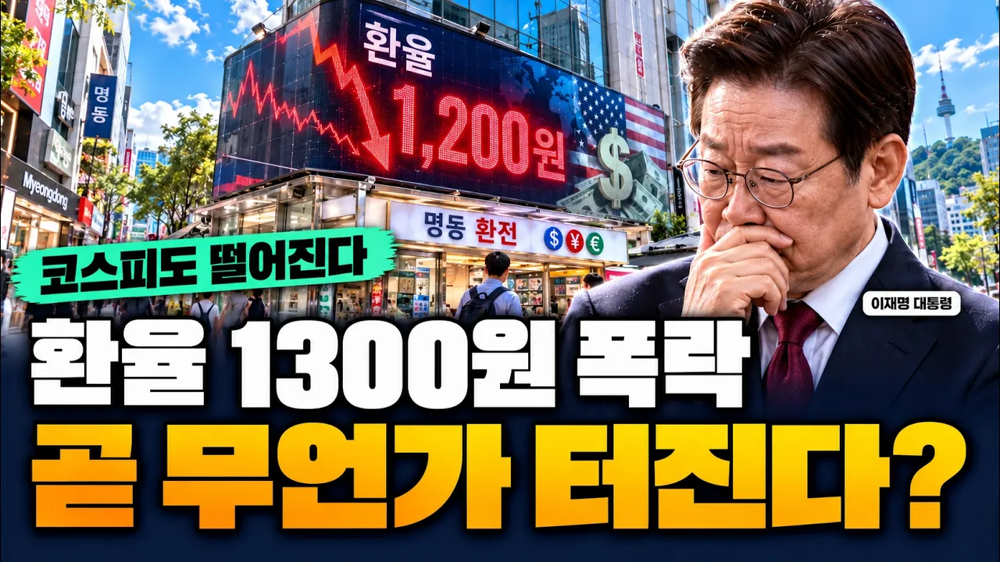

# 환율 1300원, 코스피 5000 폭락..!! 한국경제 대위기 터진다..??

## 기본 정보
- **URL**: https://www.youtube.com/watch?v=uY8bXDJHswg
- **채널명**: 경제읽어주는남자
- **구독자수**: 453
- **조회수**: 104,735
- **업로드일**: 2026-10-23
- **영상 길이**: 13:47
- **댓글 수**: 132
- **좋아요 수**: 639

## 썸네일

---

## 댓글 (추천순 TOP 10)

| 순위 | 좋아요 | 댓글 |
|------|--------|------|
| 1 | 6 | 📌오늘 퀴즈 정답을 아래 링크 클릭후 보내주시면 신청 완료입니다
 👉https://forms.gle/wai32R4hsYLPJJd29 |
| 2 | 1 | 3 |
| 3 | 0 | 금모의기 |
| 4 | 34 | 언제는 환률높다고 지랄들하더만 이젠 낮다고 지랄하네 |
| 5 | 5 | 환율 올랐을 때 나라 망할 것 처럼 떠들더니 이제 와서 딴 소리네 . |
| 6 | 12 | 환율이 폭락해서 큰일났다는. 참 희한한 놈을 다 보네.ㅋㅋ |
| 7 | 4 | 환율은 내려가야 수입물가잡혀요 |
| 8 | 2 | 다른분보다 내생각과 가장비슷한분이시네 구독박고갑니디 |
| 9 | 8 | 글구 고점서 마구 빚투하는 개미들 무슨배짱이냐 ? 매도하고 나왓어야지 |
| 10 | 3 | 올라도 나라망하고 내려도 망하면 어떻하라는거냐 ㅋㅋ 그냥 망하길바라는건 아니냐? ㅋㅋ |
