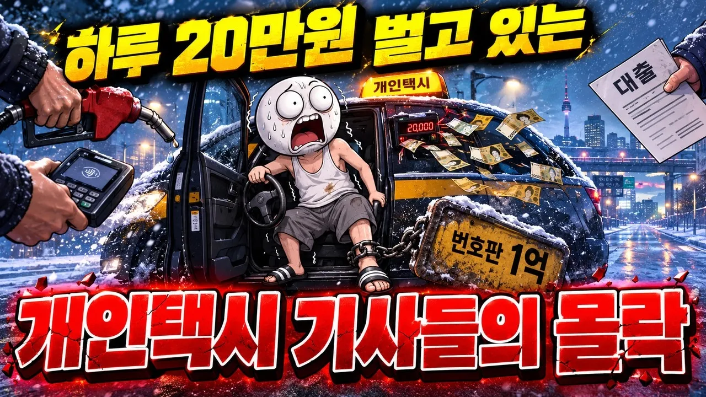

# 번호판에 1억 내고 달린다 개인택시 기사들의 몰락

## 기본 정보
- **URL**: https://www.youtube.com/watch?v=JQTGWaJPKnA
- **채널명**: 판교건물주
- **구독자수**: 523
- **조회수**: 318,347
- **업로드일**: 2026-10-19
- **영상 길이**: 14:43
- **댓글 수**: 247
- **좋아요 수**: 996

## 썸네일

---

## 댓글 (추천순 TOP 10)

| 순위 | 좋아요 | 댓글 |
|------|--------|------|
| 1 | 25 | 나이먹고다른거할거있음  땍시안함 현실적으로 할게없음 |
| 2 | 21 | 법인도 월천 찍는사람들 있습니다; 하지만 한순간에 골로가는 지름길이죠 |
| 3 | 33 | 택시는 하는게 아니다 |
| 4 | 14 | 요금이 너무싸다 그렇다고 버스처럼 보조해주지도 않는다 |
| 5 | 1 | 총체적.   공급과잉. 과거. 8구십년대.  거의 무제한 증차.  요금억제하며.  증차. 버스요금보다 싼 기현상 도벌어지고. 지금 1.6km기본 16km운행하면 기본요금 ×4. 안되고 일본 미국 등 주요국은. 기본요금  ×9 이런상황에서. 서울 약7만대 택시.전세계 주요 대도시 인구 오6백에 한대 총체적 난맥. |
| 6 | 10 | 잘 돌아가는 택시 시장에 ~ 카카오가 숫가락 하나 얹져서 .. 전국  가맹 노예들이 벌어다 주는 수수료로 , 카카오는 등따시구 , 배불러죽을라함 |
| 7 | 18 | 정확한.진단하네요ㅡ하로20벌기힘들죠ㅡ다리떨리고ㅡ허리아프고ㅡ만성질환오구ㅡ몸망가지죠 |
| 8 | 8 | 창원 평일기준 10시간 15만원정도 됨. |
| 9 | 9 | 카카오태문에 망함 |
| 10 | 7 | 정리 잘 하셨네요 |
