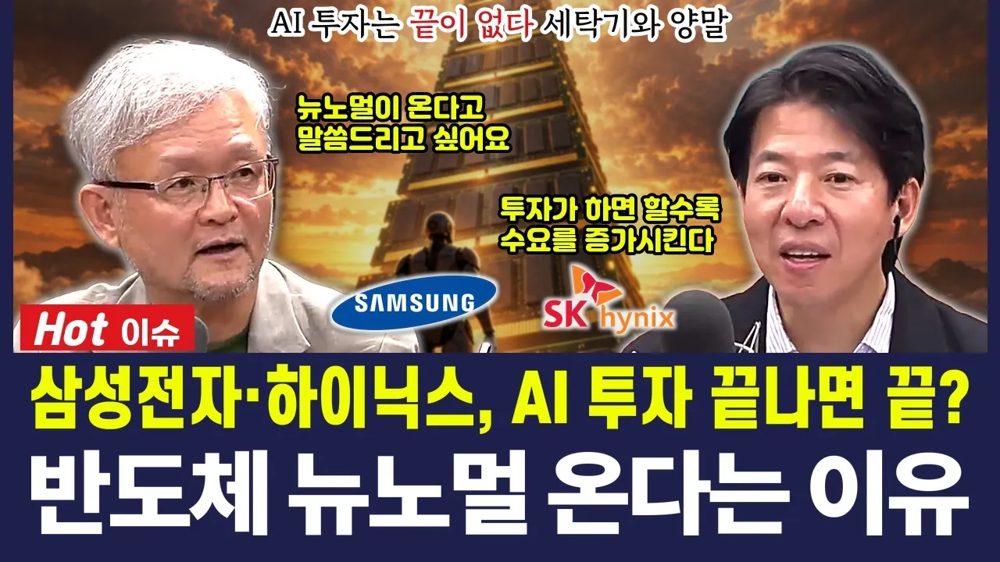

# 삼성전자·하이닉스, AI 투자 끝나면 끝? 반도체 '뉴노멀' 온다는 이유

## 기본 정보
- **URL**: https://www.youtube.com/watch?v=cPm1rukivao
- **채널명**: 경제야! 놀자~
- **구독자수**: 5,910
- **조회수**: 188,084
- **업로드일**: 2026-10-17
- **영상 길이**: 11:31
- **댓글 수**: 199
- **좋아요 수**: 1,044

## 썸네일

---

## 댓글 (추천순 TOP 10)

| 순위 | 좋아요 | 댓글 |
|------|--------|------|
| 1 | 20 | 그냥 로봇만 봐도 끝이 없을듯 인구수의 절반정도 로봇 늘어난다 |
| 2 | 0 | 인구 절반만큼 로봇이라니, 한 대마다 들어갈 반도체를 생각하면 정말 끝이 안 보이네요. |
| 3 | 0 | 인구 절반만큼 로봇이라니, 한 대마다 들어갈 반도체를 생각하면 정말 끝이 안 보이네요. |
| 4 | 11 | 몇달후에 다시 들어봐도 시나리오 훼손된게 하나없네  이런저런 이유로 주가만 빠져있는 상태이지 |
| 5 | 0 | 몇 달 지나 다시 들어 보며 맞춰 보는 게 제일 정직한 채점이죠. 이야기와 가격 사이에 벌어진 틈이 언제 좁혀질지가 남은 숙제네요. |
| 6 | 4 | 우리가 여태 쓰던 모든 전기 전자제품에 AI가 들어가고 그 성능이 더욱 높아질 걸 생각하면  반도체 수요는 폭발적으로 늘어날것으로 생각된다. 한 개 제품에 AI기능이 들어가 선두에 오르면 경쟁기업도 뒤쳐지지 않기 위해 제품에 AI기능이 들어갈거다 기업들엔 생존이 걸린 문제이고 개인들도 경쟁에서 도태되지 않기 위해 AI기능을 적극적으로 써야한다 |
| 7 | 0 | 경쟁사가 넣으면 우리도 넣을 수밖에 없다는 대목이 핵심 같아요. 다만 기기 안에서 AI를 직접 돌리려면 칩 값과 전력 부담이 커서, 얼마나 빨리 퍼질지는 그 비용이 얼마나 내려오느냐에 달린 면도 있어요. |
| 8 | 1 | 개인투자자들은 주가가 오를만한  뉴스 영상 등 좋은관점으로 이야기해주는  전문가등 그런 상황만 바라보고있습니다 그것이 진실이든 거짓이든 중요하지않아요  물린 주식을 얼른 복구하고 빠져나오기 위함이죠 |
| 9 | 0 | 물린 주식이 있으면 반가운 뉴스부터 눈에 들어오는 게 당연하죠. 다만 듣기 좋은 말일수록 근거를 한 번 더 따져 봐야, 빠져나올 시점을 정할 때도 덜 흔들려요. |
| 10 | 1 | AI, 반도체가 당연히 미래를 주도하겠지. 하지만 지금은 공급부족으로 범용 D램이 폭등한 (12만원 하던 램이 80만) 판매되는 시대라 언제까지 지속될지는 모르니 조심은 해야됨 |
