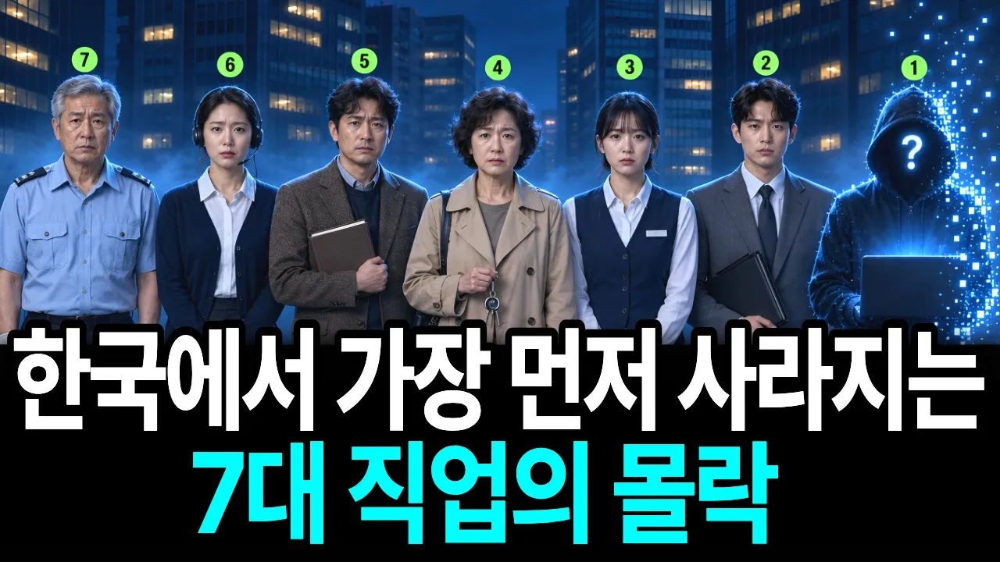

# "1등으로 합격해도 갈 곳이 없습니다" 지금 한국에서 가장 빠르게 사라지는 직업 TOP 7

## 기본 정보
- **URL**: https://www.youtube.com/watch?v=-HV2e2WMDFQ
- **채널명**: 경제상담소
- **구독자수**: 3만
- **조회수**: 1,026,322
- **업로드일**: 2026-09-25
- **영상 길이**: 24:31
- **댓글 수**: 628
- **좋아요 수**: 9,538

## 썸네일

---

## 댓글 (추천순 TOP 10)

| 순위 | 좋아요 | 댓글 |
|------|--------|------|
| 1 | 219 | 많은 분들이 댓글로 남겨주신 것처럼, 이제는 단순 시험 합격이나 간판보다 **‘10년 뒤에도 사람의 역할이 남는 분야인가’**를 먼저 고민해야 하는 시대가 된 것 같습니다.
 
 특히 댓글에서 판·검사 같은 전문직의 변화부터 현장 기술직의 가치까지 다양한 의견을 나눠주고 계신데요.
 
 여러분이 생각하시기에 앞으로 AI 시대에 끝까지 살아남을 가장 유망한 직업이나 기술은 무엇이라고 보시나요? 자유롭게 생각을 남겨주세요! 👇 |
| 2 | 6 | 진짜 판사 먼저 AI로 바꿔주길. 그게 훨씬 공정할듯. 특히 정치인들 비리 재판. |
| 3 | 1 | ❤ |
| 4 | 16 | 국회의원은 무보수 명예직으로 해야함 |
| 5 | 5 | 의료쪽이요. 간호사가, 조무사가, 요양사가 할일을 로보트가 잘할까요.? |
| 6 | 1,000 | 국개의원. 판사 부터 바꾸자. |
| 7 | 857 | 법조계가 먼저 바꿔야한다 |
| 8 | 618 | 국회의원 시의원 도의원 없어져야 된다 |
| 9 | 0 | ❤❤❤❤❤❤❤ |
| 10 | 0 | 봉사정신으로 ... 월급, 특권삭제... |
