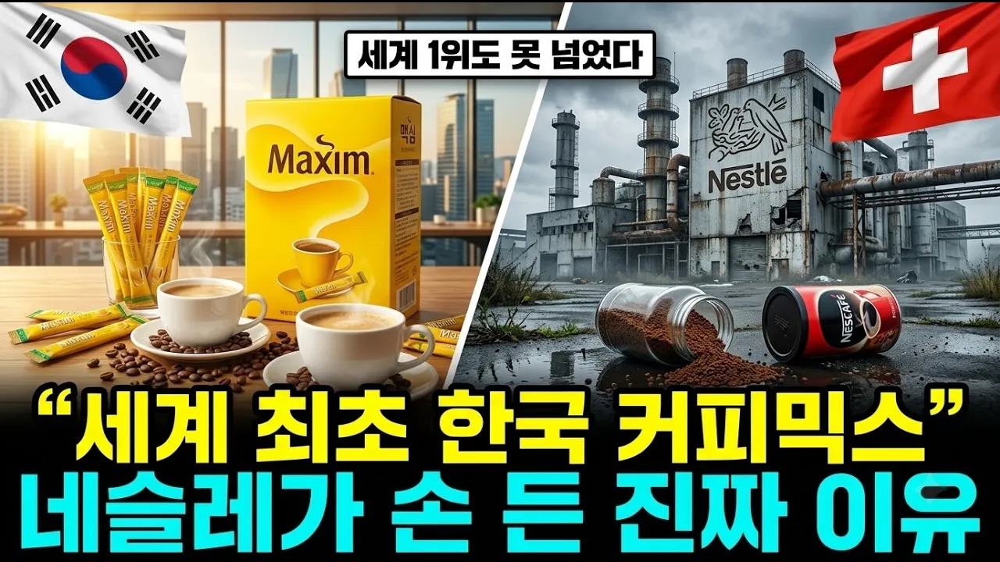

# "한국 커피믹스 하나 못 이겼다고?" 세계 1위 네슬레가 37년 만에 공장 문 닫은 진짜 이유

## 기본 정보
- **URL**: https://www.youtube.com/watch?v=YrphhHBqXh8
- **채널명**: 돈의 이야기
- **구독자수**: 926
- **조회수**: 365,292
- **업로드일**: 2026-10-15
- **영상 길이**: 35:28
- **댓글 수**: 87
- **좋아요 수**: 2,202

## 썸네일

---

## 댓글 (추천순 TOP 10)

| 순위 | 좋아요 | 댓글 |
|------|--------|------|
| 1 | 24 | 끝까지 잘 봤습니다  지금의 k-컬쳐 절호의 기회를 등에 업고 안방을 지키기보다 커피믹스 세계최초로 만든 동서식품은 이제는 세계로 나아가야만 합니다. |
| 2 | 15 | 동서식품창업주는 6.25때 서울에서 삼성의 금고를 지킨사람.그 돈으로 삼성이  재기하였으며  동서식품을 창업할때 삼성은 커피회사를 차리는걸 금지함 |
| 3 | 6 | 여긴 미국 코네티컷입니다.스몰비지니스로 남미출신 직원 둘이 있는데 맥심모카골드 마일드가 떨어지면 저에게 항의합니다.ㅋㅋ |
| 4 | 21 | 믹스커피 맥심이 젤 맛나지만 요즘 가격이 넘비싸요. 하루평균8~13잔 지금은 2~3잔으로 줄이는 친정아빠 |
| 5 | 2 | 건강을 위해서라도 믹스커피는 하루 2잔만 |
| 6 | 0 | 많이 드시고 계시면 오리지날로 바꿔 보세요 커피맛이 더 쎄서 조금 덜 마실 수 있습니다.    마냥 안 마시거나 덜 마시려고 참는게 해답은 아니잖아요 아라비카 100은 커피 함량 줄여서 그닥~ |
| 7 | 4 | 잘못된 정보 ㅡㅡ IMF기점으로 폭발한게 아니라 1990년에도 사무실 모든곳에서 마셨습니다. |
| 8 | 8 | 세계로 나가야 합니다! 이름값 50년 낸것 넘 아깝네요.동서자체로 나가도 세계가 다알듯…귀한 정보 넘 감사해요 ❤ |
| 9 | 0 | 지금도 한국 반 미국 반 합작 회사 |
| 10 | 22 | 대한민국 화이팅 최고 기술자들 감사합니다 👍 💕 😍 😘 💖 ❤️ 👍 💕 😍 😘 💖 ❤️ 👍 💕 😍 😘 💖 ❤️ 👍 💕 😍 😘 💖 ❤️ 👍 💕 😍 😘 💖 ❤️ |
