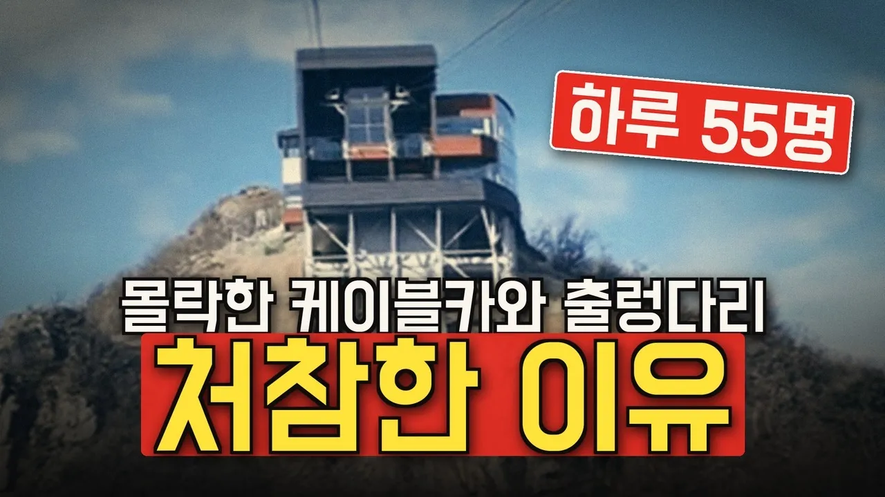

# "371억 들였는데 하루 55명" 출렁다리·케이블카 몰락 TOP 7

## 기본 정보
- **URL**: https://www.youtube.com/watch?v=_nkkfvfzuC0
- **채널명**: 경제부검실
- **구독자수**: 178
- **조회수**: 73,596
- **업로드일**: 2026-10-22
- **영상 길이**: 20:06
- **댓글 수**: 45
- **좋아요 수**: 359

## 썸네일

---

## 댓글 (추천순 TOP 10)

| 순위 | 좋아요 | 댓글 |
|------|--------|------|
| 1 | 2 | 여러분 생각은 어떠세요? 이미 지어 놓은 시설, 세금을 더 들여서라도 살려야 할까요, 정리해야 할까요? 여러분 동네의 출렁다리·케이블카 이야기도 들려주세요. |
| 2 | 15 | 나중은 모르고 세금 끌어와 업자와 관계자들 한몫 챙기는 수단입니다 |
| 3 | 19 | 도둑질 해먹을려고 공사를 하는겁니다. |
| 4 | 7 | 지방자치제 폐지! 담당공무원 책임제! 무안공항참사 특검하라. |
| 5 | 15 | 개인 돈이라면 쉽게 설치하는 결정을 못 내리지. |
| 6 | 23 | 케이블카는 돈먹는하마입니다 지자체에서 세금당겨 쓰려고 필요없는 케이블카에 주력하는거죠  지자체장님들 정신차리고 이름날리기 하지마슈  세금 아껴 필요한것에 써야지 |
| 7 | 14 | 지자체없애라 좁아터진나라에서 무슨지자체냐 세금은생산적인데사용해야지 맨날놀고먹는데 선거에도움될만한데만사용할수밖에없는구조인지자체없애지못하면 나라의미래는없다 |
| 8 | 10 | 미* 지자체들 참 한심하다. 공무원들 무슨 생각을 가지고 사는 거야 |
| 9 | 3 | 지자체 장을 조사해서   감사하고 처벌해야지 |
| 10 | 3 | 지자체에 돈 주니 주민 편의 시설에 안쓰고  저런짓만 했구나. . |
