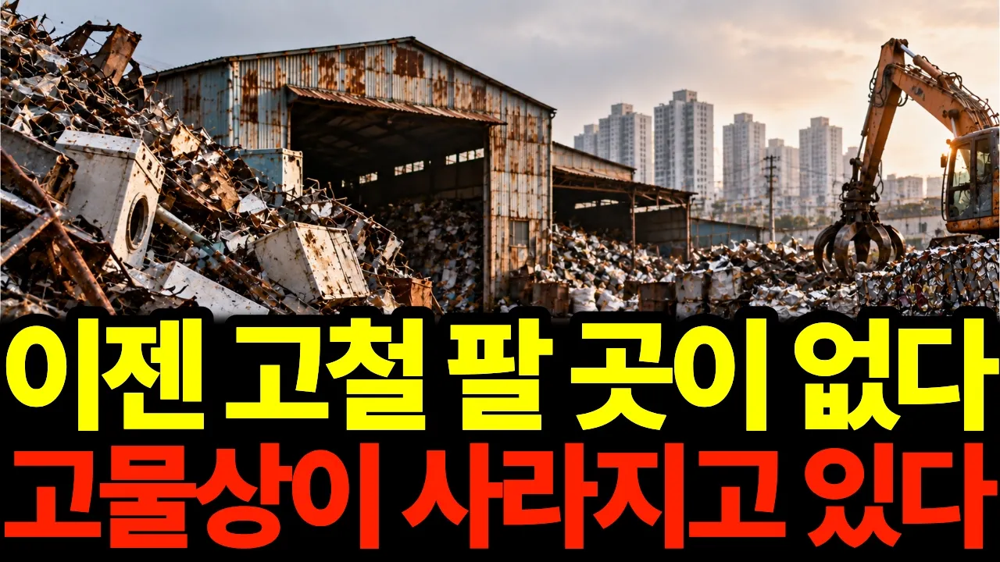

# 동네마다 있던 고물상은 왜 사라질까? 한때 돈이 되던 고철의 몰락

## 기본 정보
- **URL**: https://www.youtube.com/watch?v=Ho09oESrC_Q
- **채널명**: 이코로그
- **구독자수**: 498
- **조회수**: 151,022
- **업로드일**: 2026-10-18
- **영상 길이**: 26:11
- **댓글 수**: 11
- **좋아요 수**: 927

## 썸네일

---

## 댓글 (추천순 TOP 10)

| 순위 | 좋아요 | 댓글 |
|------|--------|------|
| 1 | 6 | 예전에는 동네마다 고물상이 하나씩 있었는데, 요즘은 찾아보기도 어려워졌습니다. 여러분 동네 고물상도 문을 닫았나요? 고물상이 사라지는 현상에 대해 어떻게 생각하시나요? 댓글로 알려주세요! |
| 2 | 1 | 동네가 어디 인지는 모르겠네요 고물상 허던사람들은 죽는날까지 고물상 히버려요 |
| 3 | 4 | 내집앞은 혐오시설이라며 반대 한다면 분료.제활성 버리지 않는다면 세상 돌아가겠는가 |
| 4 | 2 | 동네 고물상 다 없어지고 없어요 버리는것도 잘 안가져가요 |
| 5 | 9 | 그날의 시세가 적혀잏지 않은 동네 고물상은 가격편차가 너무  심합니다. 고철은 kg당 100원  이상  싸게 주는 고물상들이 많아요. 동네 고물상은 알루미늄을 kg에 1000원밗에 주지 않아요. 네이버에 검색을 해도.잘 검색되지 않아요. 제가 알기로는 kg당 가격이 2000원이 넘는것으로 알고 있는데? 한마디로. 주인 마음대로인  곳이 많아요. 고물상도  주유소처럼 가격표시를  의무화하는 법을  만들면 촣으련만? |
| 6 | 2 | 2026,  10, 23,  04:05 열공 하고 있습니다 |
| 7 | 2 | 9도카기! |
| 8 | 0 | 고물상 키로도 씩여불고 환장허것다 |
| 9 | 1 | 고단쑻99만기려! |
| 10 | 1 | 가격도 지멋대로 허구 살어불어야 |
