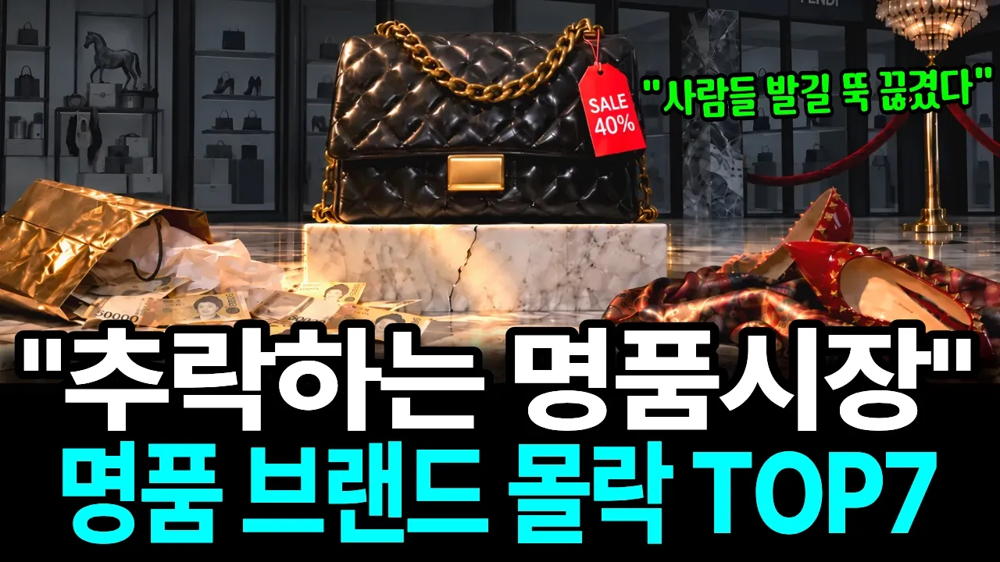

# "디올만 무너진 게 아니다" 3년 새 한국에서 매출 40% 날린 명품 브랜드 TOP7

## 기본 정보
- **URL**: https://www.youtube.com/watch?v=H7WrYR5vmzA
- **채널명**: 경제상담소
- **구독자수**: 3만
- **조회수**: 2,488,125
- **업로드일**: 2026-10-08
- **영상 길이**: 29:17
- **댓글 수**: 1,000
- **좋아요 수**: 4,556

## 썸네일

---

## 댓글 (추천순 TOP 10)

| 순위 | 좋아요 | 댓글 |
|------|--------|------|
| 1 | 272 | "비싸서 안 산 게 아니라, 너무 흔해져서 손이 안 갔다."
 영상에서 소개해 드린 브랜드들처럼, 한때 큰맘 먹고 샀지만 요즘은 옷장 깊숙이 넣어두고 잘 꺼내지 않게 된 명품 아이템이 있으신가요?
 여러분의 생생한 경험과 생각을 댓글로 자유롭게 나눠주세요! |
| 2 | 4 | 비싸서 자주 많이는 못사지만 몇개정도는  보유  특히 가방은 지금보다 쌀때 코로나때 몇개 구매한게  좋았어요 지금은 넘비싸서 윈도우 쇼핑만 |
| 3 | 4 | 명품도 너무 흔해지면 희소성이 퇴근하네요ㅋㅋ 😆 |
| 4 | 17 | 비싸서 안사요. 그 흔하다는 명품 전 없어요. 손짓 하나로 살만큼 부자고 싶어요. |
| 5 | 0 | 너무 흔해져서 손이 안가는 이유 보다는, 400만원가방이 실제가격이 8만원가방이라고 하니, 명품로고가격도 있지만,재료도 명품재료를 사용했으면,흔해져도 들고 다님. 남들시선이 8만원짜리 가방들고 다닌다고 보고있는게 기분드러움. |
| 6 | 13 | 거품바가지 사기치는 백화점 이라고들  휴휴 |
| 7 | 12 | 비싸서 안삼 |
| 8 | 10 | 에르메스.샤넬이죠.너무 흔해서.그런데도 다들 못구해서 오죽하면에루샤미만잡이라자나요.클래식은영원하다지만 그걸넘을정도로 흔한데.심지어 들기불편한백들이죠. |
| 9 | 10 | ​​ @공쥬-o1m  명품 브랜드는 개취이고 일단 돈이 없어서 못사는거임 |
| 10 | 14 | 가방 15개 있어요 옷 컨셉에 따라 들고 다녀요  뜨게질 손가방을 더좋아하지요 |
