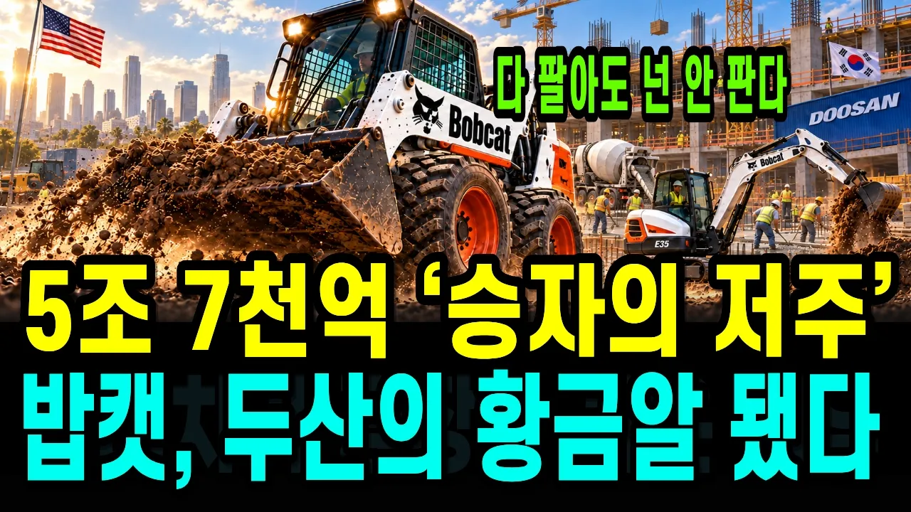

# 한국이 49억 달러에 산 미국 공장, 승자의 저주라던 15년 뒤 미국 공사장 로더 1위가 됐습니다 — 캐터필러·쿠보타를 앞에 두고

## 기본 정보
- **URL**: https://www.youtube.com/watch?v=nfHcHwfYQaM
- **채널명**: 경제솔로몬
- **구독자수**: 5,160
- **조회수**: 333,010
- **업로드일**: 2026-09-29
- **영상 길이**: 25:39
- **댓글 수**: 52
- **좋아요 수**: 1,482

## 썸네일

---

## 댓글 (추천순 TOP 10)

| 순위 | 좋아요 | 댓글 |
|------|--------|------|
| 1 | 7 | 굿. 잘 배웠습니다.  그 결단의 순간에 저라면 그렇게 뚝심있게 못했을겁니다.  박용만회장님 승! |
| 2 | 0 | 그쵸 ㅎㅎ 시장이 무너지는 상황에서 버텨낸 게 쉬운 결정이 아니었을 텐데, 결과적으로 뚝심이 빛났네요! |
| 3 | 3 | 10년 전만해도 두산이 밥캣 지뢰 밟았다고 했었는데 결국 양전했구나 |
| 4 | 1 | 그러게요 ㅎㅎ 당시엔 진짜 다들 지뢰 밟았다고 했는데, 결국 해냈네요! |
| 5 | 3 | 이건 잃어버린 20년 아닙니까.... |
| 6 | 0 | 그 시각도 충분히 이해됩니다 ㅎㅎ 15년이면 정말 긴 시간이고, 어떻게 보느냐에 따라 평가가 달라지는 것 같아요. |
| 7 | 4 | I have both bobcat skid-steer and Excavator.  I see so many bobcat machines on construction sites in Texas. |
| 8 | 1 | Bobcat everywhere in Texas! Great to hear from the field ㅎㅎ Thanks for watching all the way from the US! |
| 9 | 7 | 계차도 하나 더 필요합니다  하하 요구도 큰 결단이 필요함 나 여지에서 빠져 나가야합니다. 나중에 몰러서 헤매지 안기 해드리는 것임 증평 용강에 들어와 있는게 잘못이지 나는 방법 다 있음. ❤ 그냥 아님 다 해주고 받는 것임 ❤ |
| 10 | 2 | 모든 일이 잘 풀리길 응원합니다 ㅎㅎ! |
