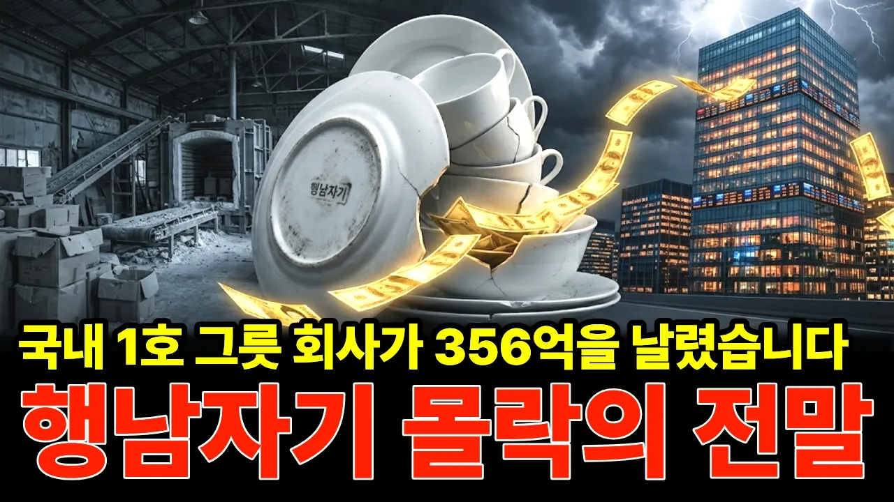

# 국내 1호 그릇 회사가 하루에 356억을 날렸습니다… 행남자기 몰락의 전말

## 기본 정보
- **URL**: https://www.youtube.com/watch?v=wWa0UqqH6O4
- **채널명**: 경제스토커
- **구독자수**: 1,230
- **조회수**: 112,034
- **업로드일**: 2026-09-26
- **영상 길이**: 15:42
- **댓글 수**: 63
- **좋아요 수**: 417

## 썸네일

---

## 댓글 (추천순 TOP 10)

| 순위 | 좋아요 | 댓글 |
|------|--------|------|
| 1 | 19 | 찬장 맨 위 칸에 행남자기 반상기, 아직 갖고 계신 분 있으실 겁니다. 결혼할 때 들어온 건지 부모님 댁에서 그대로 내려온 건지 궁금합니다. 회사는 없어졌는데 그릇은 아직 우리 집에 남아 있다는 게, 이 이야기에서 제일 이상한 부분이었습니다. |
| 2 | 3 | 뭐가 이상하지? 그럼 lg 핸드폰 망했는데 가지고 있어도 이상한거? |
| 3 | 3 | 사라지면 안돼는데. 그래도 전통있는 이런 기업들이 살아야돼는데. |
| 4 | 26 | 신규사업 무더기 추가하는 회사는 100% 상장폐지로 가는 길 |
| 5 | 0 | ❤❤ |
| 6 | 44 | 쌍방울이니 유명회사앞세우고 돈 끌어오는게 조폭건달들의 전형적 사업행태. |
| 7 | 2 | 거기도 젊은 아들이 새로운 레져사업한다고 망한거임 |
| 8 | 0 | 😂 |
| 9 | 1 | 아타까운 애기네요 .이런 전통이 있는 허ㅣ사들이 드문데  우리나라에도 백년 기업들이 나와야하는데 풍토가 이런 기업을 망치네요 . |
| 10 | 11 | 우리집에 행남자기 본차이나 반상기세트 당시 싯가 100만원짜리고 사군자가 그릇테두리에 은은한 청록색으로 박혀있는데 지금도 쓰고 있어요. 쓴지 오래됐는데도 지금껏 이 하나 안나가고 가볍고 고급스러워서 대를 물려써도 안꿀리는  그릇세트죠. 한식상차림에 빛을 발하는ㅎ회사가 없어져서 안타깝네요.ㅜㅜ |
