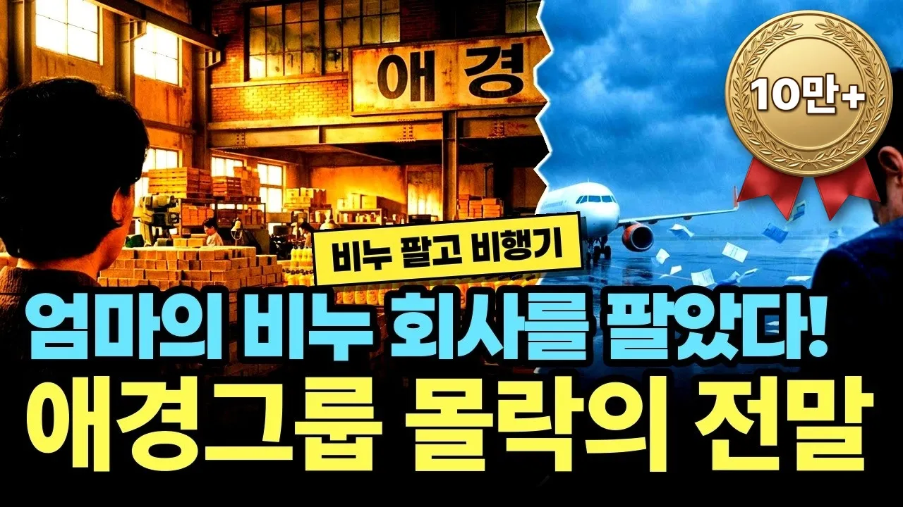

# 어머니가 키운 비누 회사를 팔아 비행기를 남겼습니다… 애경그룹 몰락의 전말

## 기본 정보
- **URL**: https://www.youtube.com/watch?v=UzQDTy2XO8M
- **채널명**: 경제꽈배기
- **구독자수**: 9,260
- **조회수**: 165,156
- **업로드일**: 2026-10-17
- **영상 길이**: 24:16
- **댓글 수**: 266
- **좋아요 수**: 2,021

## 썸네일

---

## 댓글 (추천순 TOP 10)

| 순위 | 좋아요 | 댓글 |
|------|--------|------|
| 1 | 92 | 무너지는것은 한순간 이다 |
| 2 | 59 | 폼낼려다가 회사가 날라갔다 폼낼려다 |
| 3 | 14 | 욕심이 화를 부른다는 개인이나 기업이다 매한가지 |
| 4 | 114 | 고생 안 해본 재벌2세들이 문제구만 |
| 5 | 118 | 몰랐는데 경연진의 무능함으로 회사가 무너졌다니... |
| 6 | 3 | 가습기 살균제로 7000 가까운 사람을 죽고 폐인으로 만들었음 |
| 7 | 34 | 피눈물은 무슨 국회의원 한다고 빼돌린 돈때문이지 |
| 8 | 62 | 멍청한 아들이 똑똑한 사위를 쫏아낸 결과. |
| 9 | 41 | 진로도 마찬가지였지... 진로유통, 진로 건설등 계열사를 만들다가 마침내 현금이 쏟아져 들어오는 소주회사를 넘겨주고 망해버렸죠. |
| 10 | 2 | 중간책에게 로비자금 왕창 건넸는데   '슨상님이 시방~~~' 하면서(이미 팔아먹은 뒤인데 ) 마냥  기다리게  희망고문 한 가운데,  진로 경영진이었던 절친들은 무능+방탕........ |
