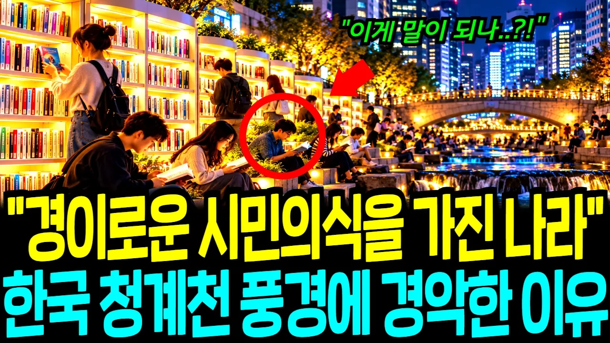

# "경이로운 시민의식을 가진 나라" 지금 전 세계가 한국 청계천 풍경을 보고 경악한 진짜 이유

## 기본 정보
- **URL**: https://www.youtube.com/watch?v=2I8GawssgQg
- **채널명**: 코믹스 경제
- **구독자수**: 3만
- **조회수**: 10,784
- **업로드일**: 2026-10-26
- **영상 길이**: 27:17
- **댓글 수**: 11
- **좋아요 수**: 372

## 썸네일

---

## 댓글 (추천순 TOP 10)

| 순위 | 좋아요 | 댓글 |
|------|--------|------|
| 1 | 7 | 우리 모두 구매한지 1년이내의 다 읽은 책을 청계천 도서관에 기증합시다 ♧♧ |
| 2 | 5 | 한국의 국제적 부상을 시기하는 일본과 중국사람들이 고의로 책을 들고가는 일이 있다고 들었습니다 잘 감시하고 우리국민은 끝까지 양심과 질서를 지킵시다 내란후 1류가 된 우리나라의 국격을 지켜나갑시다 |
| 3 | 3 | 책을 사랑 합시다 부모는 보는 눈을 주지만 책은 마음의 눈을 줍니다 |
| 4 | 2 | 우리어르신들도^책을많이읽고^많은인제도나왔지요 책속에길이있습니다^우리청소년들이여^좋은책을많이읽읍시다^책을읽으면^눈도반짝거립니다 |
| 5 | 1 | 만화가 참 좋네... |
| 6 | 1 | 자고로 책도둑은 도둑이 아니라고 했다. 공부하겠다는데...^^! |
| 7 | 0 | 후진국틀의  자찬 |
| 8 | 1 | 청계천 책은 몰라도 범죄율은 앞으로 장담못하지. 검찰청 폐지.  무능한 중수청과 경찰. |
| 9 | 0 | 갖다 붙이기는  억지소리다 |
| 10 | 3 | 그림 죠오와아~ |
