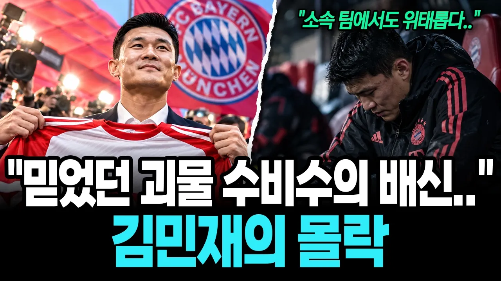

# "믿었던 괴물 수비수의 충격적인 배신.." 한국의 대표 수비수 김민재 민심이 좋지 않은 이유

## 기본 정보
- **URL**: https://www.youtube.com/watch?v=HT4SoelcobA
- **채널명**: 경제야 고맙다
- **구독자수**: 5,150
- **조회수**: 184,777
- **업로드일**: 2026-10-26
- **영상 길이**: 31:14
- **댓글 수**: 634
- **좋아요 수**: 2,471

## 썸네일

---

## 댓글 (추천순 TOP 10)

| 순위 | 좋아요 | 댓글 |
|------|--------|------|
| 1 | 407 | 손선수 없었으면 군대 끌려 갔다는것 ᆢᆢ 은혜를 원수로 갚았다는것이다 |
| 2 | 14 | 근데 이놈들은 군대가서도 훈련은 안하고96라인들만 찾으러 다니는거 아닌가??? 아예 96조직을 만들려고 ㅋㅋ두목: 김민재 행동대장: 황희찬 부대장:황인범ㅎㅎㅎ 벌써부터 그림이 그려지는데 ㅋㅋㅋㅋㅋ |
| 3 | 1 | ​ @hhhfff-cg7 교관: 포스테코클루  조교! 라멜라 페리시치 다이어   훈련병 : 손흥민 박문성 신문선 |
| 4 | 0 | @NGolo7-e1f ㅎㅎㅎㅎ |
| 5 | 3 | 손흥민있어서 다른선수들에게  빈공간이 생기는거다 |
| 6 | 15 | 입대를 하게 되었다고 해야지ᆢ ㅉㅉ 무슨생각으로 사는 사람인지ᆢ😢 |
| 7 | 5 |  @골딩이  입대=군대 끌려감 대한민국 남자 80%는 동의 할걸? ㅋㅋ |
| 8 | 0 | 아시안컵 못해도되 그냥 치고 받고 공받으려 움직이면 되 딱보면 알아 초ㅣ선인지 그냥 뛰고 싶을때만 뛰는지 팀이 우선인지 개인전인지 그거면 되 무게 네려놓길 바란다 |
| 9 | 6 | 황의조 이승우 버스로 면제당한 그선수 얘기임? |
| 10 | 4 | 솔직히 면제는 의조가 다 해줬지 |
