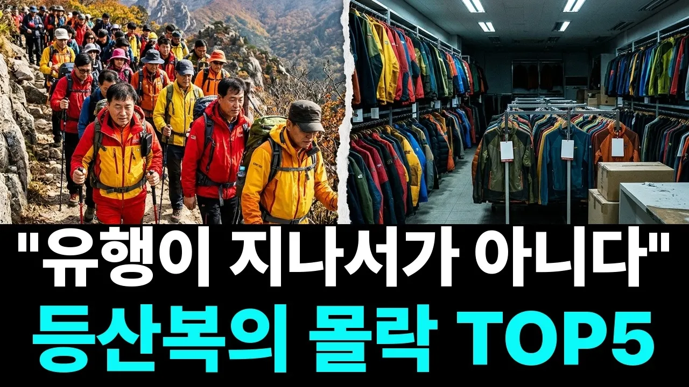

# "유행이 지나서가 아닙니다" 산에 사람은 그대로인데 등산복 브랜드가 줄줄이 무너진 진짜 이유 TOP5

## 기본 정보
- **URL**: https://www.youtube.com/watch?v=kAgEhATwFQU
- **채널명**: 머니톡
- **구독자수**: 412
- **조회수**: 365,913
- **업로드일**: 2026-10-26
- **영상 길이**: 17:20
- **댓글 수**: 175
- **좋아요 수**: 2,038

## 썸네일

---

## 댓글 (추천순 TOP 10)

| 순위 | 좋아요 | 댓글 |
|------|--------|------|
| 1 | 196 | 가격 거품때문에 망한거지요 5만원짜리를 50만원 받고 팔아처먹다 된통 당한거지뭐 꼬시다 |
| 2 | 56 | MBK, 여기에도 이게 나오네, 이정도면 이건 ...... |
| 3 | 86 | 등산복을 입는 사람들은 패션테러리스트다?.... 사지가 마음대로 돌아가지 않는 노인들에게는 최고의 일상복이다. 보온이 잘되고 활동하기 편하고, 서늘한 바람 잘 막아주고, 가볍고 이보다 좋은 옷이 어디 있나?...  어차피 늙으면 무엇을 입어도 초라하다.. 가죽 옷도 모직코트도 무겁기만하고 옷의 틀에 사람이 맞춰야 한다... 팔다리 허리 어깨 쑤셔봐라 가볍고 질기고 바람 잘 막아주고 그나마 위급할 때 몸 놀림을 편하게 해 주는 옷이 최고의 옷이다. |
| 4 | 9 | 나도 트레킹 배낭여행 세계일주댄 최고야... |
| 5 | 7 | 맞아요 👍 |
| 6 | 2 | 그건 그런데 노인만 그런건 아니지요 |
| 7 | 2 | 주머니많아서  가방도  필요없죠 |
| 8 | 89 | 등산복가격이 정장보다 비싸니 말이됩니까 거품가격으로 망했다 패션어쪄구 까불다가 이제는 안통한다 |
| 9 | 82 | 컬럼비아 고어텍스 자켓을 15년 이상 입고 있네요... |
| 10 | 13 | 고3 2000년도 컬럼비아 고어텍스 바람막이 아직도 짱짱 |
