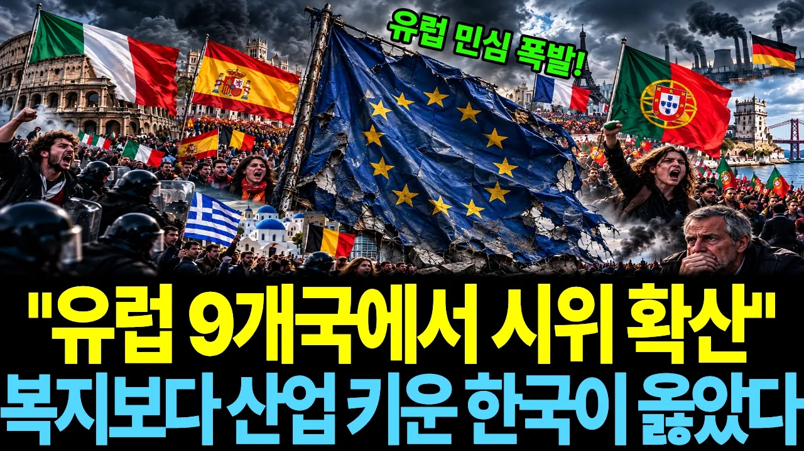

# "복지는 유럽이 훨씬 좋았습니다" 그런데 무너진 건 유럽, 한국이 버틴 진짜 이유

## 기본 정보
- **URL**: https://www.youtube.com/watch?v=YmtpiQM_GOI
- **채널명**: 경제탐정호호씨
- **구독자수**: 2,460
- **조회수**: 134,382
- **업로드일**: 2026-10-24
- **영상 길이**: 33:37
- **댓글 수**: 413
- **좋아요 수**: 3,216

## 썸네일

---

## 댓글 (추천순 TOP 10)

| 순위 | 좋아요 | 댓글 |
|------|--------|------|
| 1 | 62 | 절대 공돈을 나눠주면 안된다.  대신 열심히 일하는 사람이 잘살고  기술을 배우는 사람들에게 과감한 지원을 해주면 됩니다. |
| 2 | 149 | "일하지 않는자 먹지도 마라"  이게 불변의 진리여.. |
| 3 | 0 | 새상이 진리로 안 굴러가니 문재잖아 |
| 4 | 10 | 이 글을 진보들이 싫어 합니다. |
| 5 | 8 | "진짜 정의는 공짜로 주어지지 않습니다. 노동 없는 평등은 환상이고, 책임 없는 복지는 속임수입니다."  -찰리 커크 |
| 6 | 1 | ​ @이상호-y9t 증세 없는 복지를 누가 공약했고 대통령으로 당선이 되었지? 그 분도 좌파임? |
| 7 | 5 | ​ @이상호-y9t 이제는 진보, 보수 문제가 아니라 로봇과 AI에 밀려서 일자리 없어서 못먹고 살지도....  그러면 나라를 운영할 세금은 어디서 마련할것인가? 당연히 기업에서 점점 더 많이 걷게되겠지. 그러면 기업은 생산성과 수익을 더 크게 하려면 로봇과 AI에 더 집중하고 젊은이들 일자리는 급속도로 줄어든다.  아직도 좌우타령인가...... |
| 8 | 0 | 귀족이 일하냐😂 |
| 9 | 34 | 퍼주기 기초연금 최소화하라 |
| 10 | 29 | 가족들 굶기지 않는 것이 최우선. 그렇게 살았음. |
