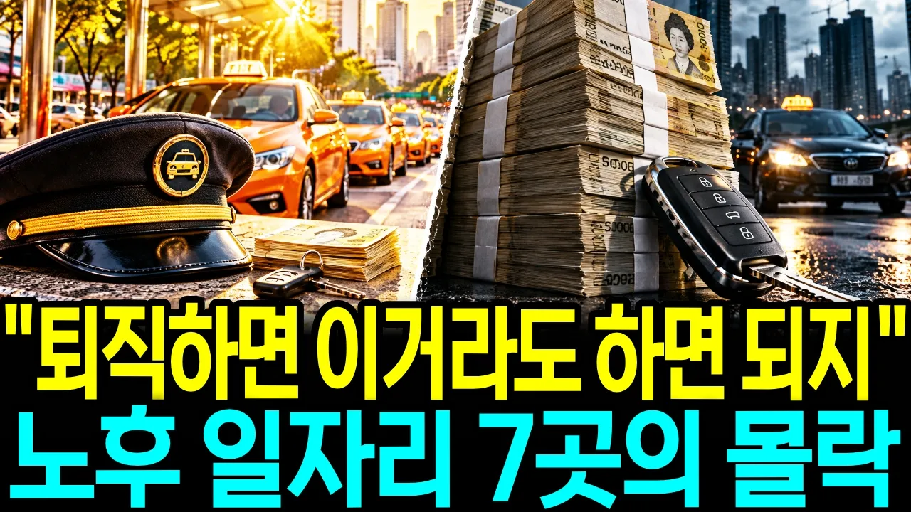

# "퇴직하면 택시라도 몰면 되지" 면허값은 1억을 넘었는데, 퇴직자가 기대던 자리는 닫는 곳이 더 많다 | 노후 일자리 몰락 TOP7

## 기본 정보
- **URL**: https://www.youtube.com/watch?v=IeOnspkz6rE
- **채널명**: 지갑연구소
- **구독자수**: 760
- **조회수**: 192,114
- **업로드일**: 2026-10-23
- **영상 길이**: 26:04
- **댓글 수**: 66
- **좋아요 수**: 374

## 썸네일

---

## 댓글 (추천순 TOP 10)

| 순위 | 좋아요 | 댓글 |
|------|--------|------|
| 1 | 2 | 🙏 퇴직 뒤 일자리 일곱 곳, 끝까지 함께 따져 주셔서 감사합니다 📌 퇴직하면 해 보려던 일, 오늘 일곱 자리 안에 있으셨나요? 번호로 적어주세요~ 1. 택시나 공인중개사처럼 자격·면허로 하는 일 2. 치킨집처럼 퇴직금 넣고 하는 가게 3. 경비나 인력시장처럼 몸으로 하는 월급 자리 4. 일곱 자리 말고 다른 일을 생각 중  👇 자격증만 있으면 될 줄 알았던 분들, 따고 나서 어디서 막히는지 이 영상에서 이어서 보세요 👇 👉 https://youtu.be/m0tl19GBQlU |
| 2 | 6 | 중소도시인데 택시기사들 1년에 한두명은 차안에서 쉬다 죽는데요 스트레스도 심하고 몸관리 제대로 못하면 위함합니다 |
| 3 | 1 | @kim453-w7l 택시 일이 체력적으로도 정신적으로도 쉽지 않다는 현장 이야기를 남겨주셨네요. 오래 앉아서 운전하는 일이라 건강 관리가 특히 중요하다는 말씀도 와닿습니다. 의견 나눠주셔서 감사합니다 🙏 |
| 4 | 6 | 택시값이 오른게 아니라 시중에 돈이 많이 풀려 돈가치가 하락해서 오른거라봐도 무방합니다.  즉, 인플레이션이 심각한데 택시면허가격이 안 오른는게 이상한거죠 |
| 5 | 1 | 인플레이션과 화폐 가치 변화가 자산 가격에 영향을 준다는 관점은 충분히 생각해볼 만한 부분이네요. 면허 가격을 바라보는 시각을 나눠주셔서 감사합니다 🙏 |
| 6 | 2 | 주식에 투자 않은 게 천만다행 입지요. |
| 7 | 0 | 주식에 투자하지 않으신 게 다행이라고 느끼실 만큼 요즘 시장 걱정이 크셨나 봅니다. 의견 나눠주셔서 감사합니다 🙏 |
| 8 | 2 | 1억 면허사고 차사고 ~~ 절대 택시하지는 마세요! 건강 해칩니다. |
| 9 | 1 | 건강 걱정까지 담아 남겨주신 경험담 감사합니다 🙏 |
| 10 | 7 | 현직 서울개인택시 기사입니다.한국택시요금이 싸서 체력을 갈아넣어야 돈버는 구조입니다.월 500이상 버는 분들도 있지만 많지는 않고 대부분 순수익 250~400구간이 제일 많습니다.주식폭락 하면서 급격히 손님감소 하는게 눈에 보이는데요.나이먹어 써주는데도 없고 내몸 팔아 돈벌기는 이만한것도 없어요.안망하는 자영업이긴 한데 운전에 재능이 없거나 사고 많이내는 사람은 보험료가 어마어마 해서 망할수도 있습니다.그런 사람은 면허 팔아야죠 |
