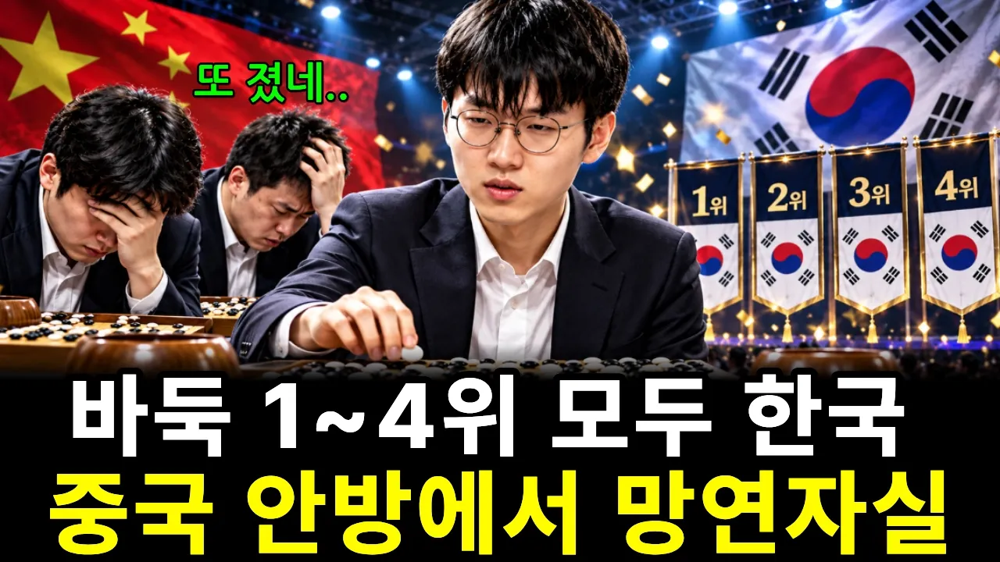

# 중국이 한국 바둑을 이기지 못 하는 진짜 이유. 한국의 보물 신진서.

## 기본 정보
- **URL**: https://www.youtube.com/watch?v=4vbC1Hg_ejw
- **채널명**: 박영만TV
- **구독자수**: 236
- **조회수**: 42,182
- **업로드일**: 2026-10-18
- **영상 길이**: 20:38
- **댓글 수**: 12
- **좋아요 수**: 424

## 썸네일

---

## 댓글 (추천순 TOP 10)

| 순위 | 좋아요 | 댓글 |
|------|--------|------|
| 1 | 11 | 고구려 ,고려가 중국의 백만대군을 상대로 거둔  대첩들이 생각나게 하는 우리 바둑입니다 |
| 2 | 5 | 이세돌이 은퇴하니 또 나왔다😅😅신진서😅😅 |
| 3 | 0 | 대한민국 바둑! 오래도록 승리하리라!!!✌✌✌✌ |
| 4 | 3 | 구독합니다 목소리. 깔끔한정리 최고입니다 |
| 5 | 2 | 쇼트트렉에서 중국3명, 한국1명인데 한국이 1등. 바둑 저번에도 다른 한국선수들 다 패해서 신진서 혼자 남았는데 3명의 중국 선수들 다 발라버리더니 이번엔 4명? 대단해요 신진서... |
| 6 | 2 | 금수강산 우리의 이강토는 하늘이 점지한 곳이라 지하자원은 없어도 인적자원 머리의 명석함을 주셨다. 땅은 같은 땅이라도 중국은 우리나라만큼 인삼이 되지 않는 거와 같이 사람의 머리 명석도 이와 같아 바둑에서도 같은 이치이니    어쩔수 없는거 아닌가. 이를 간파한 섭위평이가 잉창지배 1,2회 우승을 조훈현, 서봉수가 차지하는걸보고 중국 자국 바둑 갑조리그에 한국 랭킹 10권 기사를 승리수당 주며  용병으로 초청하는거 아니겠는가.  즉 "한국바둑을 모르면 안된다"  수수년 전엔 중국이 세계기전 개최하면 한국기사가 다차지하는데 세계기전 만들면 뮈하노 였어요. |
| 7 | 2 | 한국바둑은 된장묵은지😂😂 10년쯤에 천재가 한사람씩 나오는데 중국에 일당백이다ㆍ신공지능후계자 곹나온다😂😂😂😂😂😂😂 |
| 8 | 2 | 강한이유 = 돈때문 아이가 우리중ㄱ구은 상금 타면 70% 중국기원에 상납하고 남조선은 3%만 한국기원에 상납한다더라  내가 ㅇ아그래도 화가나는데  이것까지말해야 하나  자세히 알아보면  알거아니가 |
| 9 | 3 | 머리가 좋은가? |
| 10 | 0 | 나는 다 아는 내용이지만...이 유투버는 내용풀이를 좀 잘 못하네용.... |
